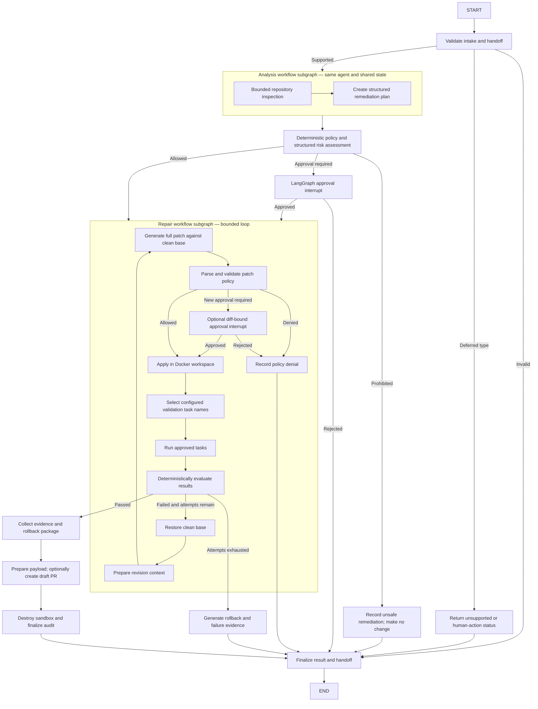

# AIOS Resolution/Remediation Agent Implementation Plan

> Implementation status (2026-08-02): Core Phases 1–5 and the Phase 6 security/demo/documentation work are implemented for the local academic prototype. The opt-in PostgreSQL restart test still needs an available local database to execute, and protected CI/image provenance changes require human approval. EKS remains deferred.

## 1. Repository assessment

The workspace root contains the shared proposal and report template but is not itself a Git repository. `remediation-agent/` is an independently versioned Git repository. At assessment time it was a minimal Python 3.12 FastAPI template named `agent-template`, with an empty README, one hello-world module, two API tests, a non-root service Dockerfile, `uv`, Ruff, strict mypy, pytest/coverage, Bandit, pip-audit, and reusable GitHub Actions workflows.

The baseline commands `uv sync --frozen`, `make lint`, `make format-check`, `make typecheck`, and `make test` passed. The two baseline tests reported 80% coverage and one Starlette/httpx deprecation warning. No LangGraph workflow, remediation schema, sandbox, model provider, PostgreSQL checkpointer, policy engine, repository adapter, or PR provider existed.

The reusable CI and image workflows reference another repository at mutable `@main`, and the builder image is not digest-pinned. These are supply-chain risks; changing them requires explicit review because CI and image provenance are security-sensitive.

## 2. Assumptions

- Agent 3 owns only the Resolution/Remediation Agent. Other team members own Agents 1, 2, and 4.
- Agent 2 and Agent 4 have not finalized integration contracts, so Agent 3 defines provisional, versioned v1 JSON handoffs for team review.
- AWS Bedrock is the deployment-target LLM provider. OpenAI and DeepSeek are optional local development providers behind the same interface.
- Model IDs, regions, credentials, and policy values are operator configuration; no current model name is hard-coded.
- The demonstration sandbox is Docker. Tests normally use fakes or disposable local fixture workspaces.
- PostgreSQL is the persistent local checkpointer and is provisioned through Compose. Unit tests use LangGraph's in-memory saver.
- GitHub writes default to disabled. A draft-PR payload is always produced; real branch/push/draft creation is opt-in.
- The HTTP request runs synchronously until completion or a human-approval interrupt.
- The committed demo policy contains explicit example limits, but the application has no hidden production safety defaults.

## 3. Scope and non-scope

### In scope

Given an evidence-supported diagnosis and repository reference, the prototype validates the request, inspects a bounded repository view, creates a structured plan, assesses risk, pauses when approval is required, generates and preflights a unified patch, applies it in a restricted workspace, runs configured validation tasks, evaluates results deterministically, revises from a clean base within a configured attempt limit, prepares rollback evidence, and prepares or optionally creates a draft PR.

### Deferred or unsupported

Account unlock, password reset, access provisioning, privileged-access changes, software-request fulfilment, direct production remediation, deployment, rollback execution, PR merge, EKS/Kubernetes deployment, shared four-agent orchestration, RAG/vector retrieval, and learned long-term memory remain outside the current implementation. Typed results use `NOT_IMPLEMENTED`, `HUMAN_ACTION_REQUIRED`, or `UNSUPPORTED_REMEDIATION_TYPE` as appropriate.

## 4. Architecture decision and one-agent justification

The system is one Resolution/Remediation Agent implemented as one parent LangGraph `StateGraph`. Two nested workflow subgraphs group analysis and repair stages. A subgraph is a code-organization and checkpointing construct, not an independent agent.

All stages share one agent ID, one `RemediationState`, one LangGraph thread/checkpointer, one policy engine, one structured-model interface, one tool-authority boundary, and one final handoff. There are no independent goals, personas, memories, prompts, or permissions and no supervisor, planner agent, coder agent, reviewer agent, or tester agent.

LangGraph interrupts resume by restarting the interrupted node, so approval nodes are idempotent and all side effects occur after the interrupt. Subgraphs inherit the parent checkpointer and share the same state contract.

References:

- [LangGraph subgraphs](https://docs.langchain.com/oss/python/langgraph/use-subgraphs)
- [LangGraph interrupts](https://docs.langchain.com/oss/python/langgraph/interrupts)
- [LangGraph persistence](https://docs.langchain.com/oss/python/langgraph/persistence)

## 5. LangGraph topology



## 6. State schema

`RemediationState` is a typed LangGraph `TypedDict`. Complex values are Pydantic models. Persisted state is JSON-safe and never uses pickle fallback.

- Identity: `agent_id`, case ID, run/thread ID, input schema version, prompt version, and policy version.
- Intake: issue summary, diagnosis, evidence, acceptance criteria, repository/base branch/commit, and remediation type.
- Workspace: workspace reference/status and bounded inspection artifacts.
- Decisions: remediation plan, risk assessment, deterministic policy decisions, approval request, and approval history.
- Change: patch candidate, changed files, full bounded current diff, digest, and patch provenance.
- Loop: attempt counter, configured maximum, validation attempts, and test/lint/type-check/scanner results.
- Outcome: residual risks, rollback instructions, draft-PR metadata, artifact manifest, cleanup result, and final status.
- Explainability: model call records, structured errors, and append-only audit events.

Routing fields are enums: `RiskLevel`, `PolicyDecision`, `ApprovalStatus`, `RemediationType`, `ValidationOutcome`, and `FinalStatus`. Free-form model text never controls an edge.

## 7. Node responsibilities

### Parent workflow

- `validate_intake`: validates the v1 handoff, evidence references, repository reference, and required acceptance criteria.
- `classify_scope`: returns unsupported/human-action results for deferred remediation types.
- `assess_risk`: combines deterministic policy findings with structured model observations; policy can only raise severity.
- `plan_approval`: interrupts for a plan-hash-bound decision when required.
- `finalize`: builds the typed Agent 4 handoff for every terminal path.

### Analysis subgraph

- `inspect_repository`: executes only bounded typed tree/read/search requests and records provenance.
- `create_plan`: requests a typed remediation plan and proposed validation task names from the configured model.

### Repair subgraph

- `generate_patch`: requests a complete unified patch against the immutable clean base.
- `preflight_patch`: parses paths and hunks, enforces limits and policy, and rejects unsupported diff features.
- `patch_approval`: interrupts when the exact diff introduces new approval scope.
- `apply_patch`: applies only a successfully preflighted patch.
- `select_validation_tasks`: intersects model suggestions with configured names and adds policy-mandatory tasks.
- `run_validation`: runs configured argv arrays in the sandbox.
- `evaluate_validation`: deterministically passes only when all required tasks succeeded.
- `restore_base`: discards a failed attempt and proves the workspace is clean.
- `revise`: prepares bounded failure context for the next full-patch generation.
- `collect_evidence`, `prepare_pr`, and `cleanup`: create the final artifacts and always destroy the sandbox.

Approvals are bound to the exact plan or diff hash. Changed sensitive scope invalidates prior approval. Side-effecting providers use idempotency keys.

## 8. Tool interfaces

The workflow depends on narrow typed protocols rather than generic tools:

```python
class RepositoryPort(Protocol):
    async def create_workspace(self, ref: RepositoryRef) -> WorkspaceRef: ...
    async def list_tree(self, request: TreeRequest) -> TreeResult: ...
    async def read_file(self, request: ReadFileRequest) -> FileContent: ...
    async def search(self, request: SearchRequest) -> SearchResult: ...
    async def current_diff(self, workspace: WorkspaceRef) -> DiffResult: ...
    async def create_branch(self, request: BranchRequest) -> BranchResult: ...
    async def commit(self, request: CommitRequest) -> CommitResult: ...
    async def push(self, request: PushRequest) -> PushResult: ...

class SandboxExecutor(Protocol):
    async def apply_patch(self, request: PatchApplyRequest) -> PatchApplyResult: ...
    async def restore_base(self, workspace: WorkspaceRef) -> None: ...
    async def run_task(self, request: ValidationTaskRequest) -> ValidationTaskResult: ...
    async def collect_artifacts(self, workspace: WorkspaceRef) -> ArtifactManifest: ...
    async def destroy(self, workspace: WorkspaceRef) -> CleanupResult: ...

class StructuredModel(Protocol):
    async def generate(self, request: ModelRequest, output_schema: type[T]) -> ModelGeneration[T]: ...

class PullRequestProvider(Protocol):
    async def prepare(self, request: DraftPrRequest) -> PreparedDraftPr: ...
    async def create_draft(self, request: DraftPrRequest) -> CreatedDraftPr: ...
```

The model never receives these protocols as callable tools. Workflow code validates and mediates every request.

## 9. Repository abstraction

- Clone or copy the referenced repository at an immutable base commit and reject a moving-base mismatch.
- Canonicalize every path beneath the workspace using `lstat`; reject absolute paths, traversal, NULs, `.git`, secret/key files, and symlink escape.
- Bound tree depth/count, read bytes, search queries/results, and total context.
- Run fixed Git and ripgrep argument arrays without a shell.
- Parse unified diffs before `git apply --check`; inspect old/new paths, file and line counts, deletion/rename metadata, binary markers, modes, and submodules.
- Hard-deny forbidden targets. Paths outside the autonomous allowlist but not forbidden require diff-bound approval.

## 10. Sandbox abstraction

The Docker implementation runs a separate validation image as non-root with no network, no Docker socket, a read-only root filesystem, dropped Linux capabilities, process/memory/CPU limits, and one writable workspace mount. Only named tasks from operator policy can run. Each task has an argv array, cwd, environment allowlist, timeout, output cap, and explicit retryability. The current base-image tag is recorded but not digest-pinned; digest pinning remains protected supply-chain work.

Fake/temp executors support unit tests. A future `KubernetesJobSandboxExecutor` implements the same interface without graph redesign; no EKS resources are added now.

## 11. Bedrock and local model abstraction

- Bedrock uses `ChatBedrockConverse` from `langchain-aws` and is the deployment target. See [LangChain AWS integration](https://docs.langchain.com/oss/python/integrations/providers/aws).
- OpenAI local experiments use `ChatOpenAI` and schema-constrained output. Documentation calls it the OpenAI API, not a ChatGPT subscription/API. See [OpenAI structured outputs](https://developers.openai.com/api/docs/guides/structured-outputs).
- DeepSeek local experiments use `ChatDeepSeek` and the same Pydantic contracts. See [LangChain DeepSeek integration](https://docs.langchain.com/oss/python/integrations/chat/deepseek).
- `FakeStructuredModel` is the default in automated tests.

Provider, model/inference profile, region/base URL, timeout, retries, output-token limit, and temperature are settings. Use deterministic temperature where supported. Record model/provider/prompt version, latency, usage, refusal, and response digest without persisting secrets or unrestricted prompts.

## 12. Pull-request provider abstraction

Always generate a deterministic `DraftPrPayload`. GitHub writes default off. When trusted configuration enables them, typed Git/GitHub adapters create a case-scoped branch, commit, push, and draft PR using idempotency keys. The PR body contains diagnosis/evidence, plan, changed files, all validation evidence and failed attempts, residual risks, rollback, approvals, and a mandatory human-review statement. The system never exposes merge.

If remote creation fails, retain the validated patch and payload with `DRAFT_PR_PREPARED` and an error record.

## 13. Policy and approval model

Operator JSON policy is authoritative and is loaded from `AIOS_POLICY_FILE`. Pydantic rejects unknown fields and missing required values; there are no hidden safety defaults.

The policy defines:

- autonomous, approval-required, and forbidden paths;
- autonomous and absolute file/diff limits;
- patch-validation and model-format attempt limits;
- inspection, context, token, timeout, output, and retention limits;
- validation tasks as argv arrays plus cwd/environment/timeout/output/retry rules;
- sensitive areas and mandatory task mappings;
- artifact/audit and optional GitHub-write controls.

Known authentication/security weakening, production actions, privileged identity changes, secret access, traversal/symlink escape, forbidden targets, and absolute-limit violations are prohibited. Legitimate auth/authz, IAM, Kubernetes, Terraform, CI/CD, migration, dependency, test/security-control, soft-limit, and outside-autonomous-path changes require approval.

## 14. Configuration strategy

- Environment settings select policy path, provider/model details, PostgreSQL DSN/encryption key, artifact root, and local HTTP settings.
- The JSON policy contains permissions and limits but no credentials.
- `.env` files remain ignored; `.env.example` includes names and safe descriptions only.
- Compose provisions PostgreSQL 16 for local checkpointing. Database setup/migration is an explicit lifecycle command, not request-time behavior.
- Tests inject settings/fakes and do not read developer credentials.

## 15. Audit and explainability

Every material node, route, model call, policy check, approval, tool call, validation, cleanup, and finalization emits a redacted `AuditEvent` with stable ID, UTC time, actor, case/run ID, versions, input/output digests, duration, and result code.

Local evidence uses a hash-chained JSONL bundle. This is tamper-evident, not immutable; production WORM storage is deferred. Plans and risk decisions reference evidence IDs and policy control IDs. Credentials, suspected secrets, sensitive environment values, and user-specific filesystem roots are masked before state/log/artifact persistence.

## 16. Security threat model and OWASP GenAI 2025

Primary threat actors are malicious issue input, malicious repository content, compromised or hallucinating model output, unsafe operator configuration, a compromised dependency/provider, resource exhaustion, and failures that leave workspaces or remote side effects behind.

The implementation-time status is backed by `docs/SECURITY_EVIDENCE.md`. `MITIGATED` is limited to the academic prototype boundary. See the [OWASP Top 10 for LLM Applications 2025](https://genai.owasp.org/llm-top-10/?cat=253).

| Risk | Implementation status | Control/evidence summary |
|---|---|---|
| LLM01 Prompt Injection | PARTIALLY_MITIGATED | Repository content is untrusted; no direct model tools; adversarial fixtures and route assertions. |
| LLM02 Sensitive Information Disclosure | PARTIALLY_MITIGATED | Forbidden secret paths, redaction before checkpoint/model use, bounded context, encrypted checkpoints, leakage tests. |
| LLM03 Supply Chain | PARTIALLY_MITIGATED | Lockfile, clean pip-audit, dependency approval, and recorded versions; action/image digest pinning remains. |
| LLM04 Data and Model Poisoning | NOT_APPLICABLE | No training, fine-tuning, RAG corpus, embeddings, or learned memory; reopen if introduced. |
| LLM05 Improper Output Handling | MITIGATED | Pydantic output, diff parsing, policy validation, apply preflight, typed routing. |
| LLM06 Excessive Agency | MITIGATED | Named tools/tasks, sandbox, approvals, bounded attempts, no production authority. |
| LLM07 System Prompt Leakage | PARTIALLY_MITIGATED | Prompts contain no secrets and are not a security boundary; provider-specific extraction evaluations remain. |
| LLM08 Vector and Embedding Weaknesses | NOT_APPLICABLE | No vector database, embeddings, or retrieval workflow. |
| LLM09 Misinformation | PARTIALLY_MITIGATED | Evidence-linked diagnosis, validation evidence, deterministic evaluation, residual risks, human review. |
| LLM10 Unbounded Consumption | PARTIALLY_MITIGATED | Required token/context/attempt/time/output/per-process concurrency limits; distributed quotas remain. |

## 17. Error handling and retry strategy

- Invalid and unsupported inputs do not retry.
- Provider transport failures retry only when classified transient and within configured limits.
- Invalid structured output receives bounded schema-feedback retries.
- Validation attempts count complete applied-patch/check cycles, including the first attempt.
- Failed validation restores the clean base before a new full patch; commands are not blindly rerun.
- A task retries only when policy marks it retryable.
- Unexpected errors route to typed finalization and cleanup.
- Cleanup always runs and cleanup failure is visible in state and residual risk.
- External PR operations use idempotency keys and bounded retries.

## 18. Implemented package structure

```text
remediation-agent/
├── config/
│   ├── policies/demo.json
│   └── schemas/
├── docker/sandbox.Dockerfile
├── src/remediation_agent/
│   ├── api/
│   ├── workflow/
│   ├── domain/
│   ├── policy/
│   ├── ports/
│   ├── adapters/
│   ├── prompts/
│   └── config.py
└── tests/
    ├── unit/
    ├── graph/
    ├── security/
    ├── integration/
    └── fixtures/
```

## 19. Testing strategy

- Unit tests for deterministic nodes, schemas, policy, rollback, PR formatting, and result evaluation.
- Graph-route and state-transition tests for every terminal result.
- Shared-state/subgraph tests proving one thread and one agent identity.
- Interrupt/reject/approve/resume tests, including invalidated approval when the diff changes.
- PostgreSQL restart/resume integration test; default tests stay external-service-free.
- Fake-model tests for valid/malformed output, refusal, timeout, transient errors, and exhausted retries.
- Fake repository, sandbox, artifact, audit, and PR-provider tests.
- Patch tests for traversal, absolute paths, symlink escape, binary changes, forbidden files, excessive limits, dependency/CI changes, test removal, and authentication weakening.
- Validation-task tests proving unknown names and model-generated commands cannot execute.
- Prompt-injection and secret-leakage fixtures.
- Attempt-limit, timeout, output-cap, cleanup-failure, and idempotency tests.
- Audit-event assertions for every material action.
- Opt-in live provider smoke tests only.

Default tests require no AWS/OpenAI/DeepSeek credentials, GitHub repository, PostgreSQL, EKS cluster, or production service.

## 20. Demonstration scenarios

### Scenario A: code defect

A fixture diagnosis identifies an unhandled application conversion error. The agent updates the bounded implementation and test, runs configured unit, lint, and type-check tasks, and returns `DRAFT_PR_PREPARED` or a configured draft PR.

### Scenario B: configuration defect

A fixture contains a negative/unsafe timeout. The agent modifies one approved configuration file, runs `config_validation`, records the original value in rollback instructions, and prepares a draft PR.

### Scenario C: unsafe remediation

The diagnosis proposes disabling authentication or removing authorization. Deterministic policy returns `PROHIBITED`; no patch is applied and no validation task runs. The result is `HUMAN_ACTION_REQUIRED` or `UNSAFE_REMEDIATION` with reasons and audit evidence.

## 21. Implementation phases

1. **Scaffolding and contracts:** rename the package; add settings, handoffs, domain schemas/enums, state, JSON policy, graph/subgraph skeleton, Compose PostgreSQL, and injected checkpointers.
2. **Repository, sandbox, and policy:** add bounded inspection, diff/path/symlink controls, Docker sandbox, task resolution, artifacts, cleanup, and security tests.
3. **Structured model integrations:** add fake, Bedrock, OpenAI, and DeepSeek adapters; structured planning/risk/patch output; prompts; usage controls; provider contract tests.
4. **Bounded repair and approval:** implement patch preflight, plan/diff interrupts, application, validation, evaluation, clean reset, bounded revision, and resume/idempotency tests.
5. **PR and evidence package:** implement rollback, draft-PR payload, fake/GitHub provider, optional Git operations, redacted artifacts, and hash-chained audit.
6. **Security, demonstrations, and academic evidence:** complete OWASP tests/matrix, end-to-end fixtures, failure/cleanup tests, README/report evidence, and approved CI provenance changes.

## 22. Dependencies

Runtime additions are `langgraph`, `langgraph-checkpoint-postgres`, `langchain-core`, `langchain-aws`, `langchain-openai`, `langchain-deepseek`, `pydantic-settings`, `unidiff`, `httpx`, and the encryption package required by LangGraph's encrypted serializer. Continue Ruff, strict mypy, pytest/coverage, Bandit, and pip-audit. Lock all dependencies with `uv`; dependency changes require review.

## 23. Risks and trade-offs

- Workflow subgraphs add checkpoint/resume complexity and possible academic ambiguity; shared identity/state and explicit terminology mitigate this.
- PostgreSQL adds local setup compared with SQLite but demonstrates durable approval resume.
- Three model providers increase compatibility testing; a narrow shared interface and contract tests contain it.
- Docker isolation depends on daemon security and is not a production-grade hostile-code sandbox.
- Generated patches remain probabilistic; deterministic preflight, validation evidence, and human review are still mandatory.
- Optional GitHub writes cannot be exercised in the workspace root; fixture repositories and fakes cover the default suite.
- The local approval API does not establish trusted reviewer identity; it must not be internet-exposed.
- Large outputs and checkpoint state can leak information or exhaust storage; bounds, redaction, encryption, hashes, and artifact references reduce the risk.
- Mutable CI workflow references and unpinned images remain a supply-chain risk until an explicitly approved provenance update.

## 24. Acceptance criteria

- The repository documents and implements exactly one agent despite workflow subgraphs.
- Inputs, outputs, state, routes, approvals, and tool requests are typed.
- No model can directly choose a command, bypass policy, or access production.
- PostgreSQL-backed approval resume survives application recreation.
- All three demonstration scenarios pass with fakes and fixture repositories.
- Unsafe Scenario C causes zero workspace mutation.
- The repair loop stops exactly at configured limits.
- A successful run includes validation evidence, rollback, residual risks, audit bundle, and draft-PR payload.
- OWASP statuses are evidence-backed.
- Formatting, lint, strict mypy, tests, security checks, and build pass.
- No EKS deployment, production remediation, privileged identity action, or automatic merge exists.

## 25. Open questions and coordination

- Agent 2 and Agent 4 owners must ratify the provisional v1 handoffs. Until then, changes are additive and versioned.
- Operators must supply actual provider models/regions, PostgreSQL secrets, policy values, and optional GitHub details; missing values fail closed.
- Production API authentication, durable artifact storage, immutable audit storage, secret-manager integration, and Kubernetes execution remain deferred residual risks.
- Real remote branch/PR testing requires a configured repository and credentials; the default suite uses fakes.

## 26. Definition of done

Each phase must preserve Agent 3 scope and the one-agent design, keep deterministic routing and least privilege, add appropriate unit/graph/security/integration evidence, redact audits, update documentation, pass all quality/security/build commands, require no live credentials in default tests, and avoid production mutation, automatic merge, and EKS work.

## 27. Recommended next task

Start the local PostgreSQL service, run the opt-in restart/resume integration test, and capture its evidence. Then ask the Agent 2 and Agent 4 owners to ratify the exported v1 handoff schemas. Treat CI reusable-workflow and image digest pinning as a separate explicitly approved security change.
