# AIOS Resolution/Remediation Agent

This service implements the **Resolution/Remediation Agent**, for **AIOS: Agentic AI for IT Operations Support**. It turns a diagnosis into a policy-checked code or configuration change, validation evidence, rollback instructions, and a draft pull-request payload.

The implementation changes only disposable repository workspaces. It cannot merge a pull request, deploy, mutate production, or perform identity and
privileged-access operations. The HTTP API does not implement caller authentication; deployment and network controls must restrict access to authorized operators.

The presentation-only [`demo-ui`](demo-ui/README.md) provides a React dashboard and public Lambda Function URL gateway
for manually submitting the Agent 2 handoff to the hosted AgentCore runtime. It intentionally has no end-user
authentication and must not be treated as a production interface.

## Agent details

| Property | Implementation |
|---|---|
| Identity | One `resolution-remediation-agent` |
| Orchestration | One stateful parent LangGraph workflow with analysis and repair workflow subgraphs |
| Input | Versioned `DiagnosisHandoffV1` from the Investigation/Diagnosis Agent |
| Output | Versioned `RemediationHandoffV1` for the Verification/Monitoring Agent |
| Supported remediation | Bounded `CODE` and `CONFIGURATION` changes |
| Human-only remediation | Account unlock, password reset, access provisioning, privileged access, and production changes |
| Persistence | In-memory checkpoints in tests; encrypted PostgreSQL locally; encrypted AgentCore Memory when hosted |
| Approval | LangGraph interrupts bound to an exact plan or patch digest |
| Deployment-target model provider | AWS Bedrock through `ChatBedrockConverse` |
| Execution boundary | Docker locally; isolated AgentCore Code Interpreter sessions when hosted |
| External writes | Draft-PR preparation by default; GitHub branch, push, and draft creation only when both gates are enabled |

The workflow subgraphs are organizational stages that share the same identity, state,
checkpointer, model abstraction, policy engine, tool boundary, and final outcome.

## How the workflow operates

```mermaid
flowchart LR
    Intake["Validate intake"] --> Analysis["Analysis workflow subgraph"]
    Analysis --> Workspace["Create immutable-base workspace"]
    Workspace --> Inspect["Model ↔ GitHub hosted MCP inspection loop"]
    Inspect --> Plan["Create structured remediation plan"]
    Plan --> Risk["Policy and risk assessment"]
    Risk -->|sensitive| Approval["Checkpointed approval interrupt"]
    Risk -->|allowed| Repair["Repair workflow subgraph"]
    Approval -->|approved| Repair
    Approval -->|rejected| Evidence["Evidence and final result"]
    Repair --> Apply["Preflight and apply full patch"]
    Apply --> Validate["Run configured task names"]
    Validate -->|failed; attempts remain| Reset["Restore immutable base"]
    Reset --> Repair
    Validate -->|passed or exhausted| Evidence
    Evidence --> Draft["Prepare draft-PR payload"]
    Draft --> Cleanup["Destroy disposable workspace"]
```



The lifecycle is:

1. Validate the versioned handoff, evidence references, remediation type, and repository policy.
2. Create and checkpoint a disposable workspace at the immutable base commit.
3. Start a run-scoped Streamable HTTP session with GitHub's fixed hosted MCP endpoint. The model adaptively calls one bounded tree, file-read, search, or local finish tool per round through `ToolNode`.
4. Require at least one successful commit-pinned tree or file call, reconstruct a typed `InspectionPlan` from validated call history, then close the transient session. Search results are locator hints and are not persisted as planning evidence.
5. Ask the model for a structured remediation plan and risk observations; deterministic policy owns the final decision.
6. Interrupt for approval when the plan or exact patch crosses an approval boundary.
7. Ask the model for a complete unified patch, parse and preflight it, and apply it only inside a disposable workspace.
8. Resolve proposed validation names through operator policy and run their fixed argument arrays in Docker locally or Code Interpreter when hosted.
9. Evaluate results deterministically. Failed attempts restart from the immutable base and stop at the configured limit.
10. Produce rollback, audit, artifacts, and a draft-PR payload; optionally create a GitHub draft; always attempt cleanup.

Model output never decides whether validation passed, lowers policy severity, supplies executable command strings, or
calls workspace mutation, sandbox, Git, GitHub, artifact, approval, checkpoint, credential, or cleanup operations.

## Capabilities and tool boundary

The model-callable surface is deliberately smaller than the agent's operational surface. Repository inspection uses
three read-only MCP tools; every mutation remains a deterministic workflow action behind a typed port.

The versioned operational catalogue contains **17 implemented tools**: four model-callable inspection/control tools
and thirteen deterministic workflow-only tools. `GET /v1/tools` exposes the same strict metadata used to generate
[`docs/TOOL_CATALOG.md`](docs/TOOL_CATALOG.md), including each tool's typed boundary, authority, availability gate,
description, model-visible argument names, and safety controls. Catalogue entries are operations of this one agent, not
agents or subagents. The hosted-tool migration advances the catalogue response to version `1.1`.

| Capability | Typed boundary | Current implementation and controls |
|---|---|---|
| Repository inspection | `InspectionToolProvider` / `RepositoryInspectionPort` | `GitHubRemoteMcpInspectionTools` connects only to GitHub's hosted read-only MCP endpoint. Repository identity, immutable SHA, paths, search scope, schemas, redaction, and output bounds are enforced by the host adapter. |
| Workspace and Git mutation | `RepositoryWorkspacePort` | `LocalGitRepository` creates the immutable-base workspace and performs diff, branch, commit, and push operations using fixed argument arrays. These operations are never model-callable. |
| Patch and validation | `SandboxExecutor` | `DockerSandboxExecutor` is used locally; `AgentCoreCodeInterpreterSandbox` retains the patch boundary and validates a sanitized copy in an isolated managed session. |
| Structured model inference | `StructuredModel` | Provider adapters normalize one inspection tool call per turn and return Pydantic-validated plan, risk, patch, and revision objects with bounded retries and recorded metadata. |
| Pull-request handling | `PullRequestProvider` | A deterministic draft payload is always prepared; authenticated GitHub draft creation is separately gated and merge is unavailable. |
| Evidence and audit | `ArtifactStore`, `AuditSink` | Local files or immutable digest-addressed S3 objects hold redacted artifacts and hash-chained audit events. |
| Resume and approval state | LangGraph checkpointer | Interrupt state is keyed by the run UUID and encrypted before PostgreSQL or AgentCore Memory persistence. |

The reference policy defines these validation task names:

| Task name | Reference command purpose |
|---|---|
| `unit_tests` | Run the target repository's pytest suite |
| `integration_tests` | Run tests marked `integration` |
| `lint` | Run Ruff checks |
| `type_check` | Run mypy |
| `security_scan` | Run Bandit against `src` |
| `config_validation` | Validate the demonstration JSON configuration |

These are examples in `config/policies/reference.json`, not hidden defaults or model-generated commands. An operator
reviews the policy, and the model may only suggest task names. The policy engine selects known names, adds mandatory
tasks based on changed paths, and resolves each selected name to a trusted `argv` array.

### Model-called tools and decorators

The analysis stage binds exactly four LangChain tools to the configured model:

- `get_repository_tree(owner, repo, tree_sha, recursive, path_filter)`
- `get_file_contents(owner, repo, path, sha, fields)`
- `search_code(query, sort, order, fields, page, perPage)`
- `finish_inspection(rationale)`

The first three are discovered from `https://api.githubcopilot.com/mcp/` through `langchain-mcp-adapters` and retain
their native GitHub names and schemas. Discovery must return exactly this allowlist with compatible security-critical
arguments. `finish_inspection` is a local LangChain `@tool`; it is a control signal with no repository authority. The
model must make exactly one call per round and cannot finish until a commit-pinned tree or file inspection succeeds.
`search_code` is default-branch indexed and is used only to locate candidate paths for a subsequent pinned file read.

Planning, risk, patch, and revision still use `with_structured_output(...)`. Tool decorators are not used for clone,
checkout, diff, patch application, validation, branch, commit, push, draft PR, artifacts, approvals, or cleanup because
those capabilities have side effects or determine security outcomes and therefore stay under deterministic workflow control.

### Why MCP is limited to inspection

GitHub hosts the endpoint; see its [remote-server documentation](https://github.com/github/github-mcp-server/blob/main/docs/remote-server.md)
and [setup guidance](https://docs.github.com/en/copilot/how-tos/provide-context/use-mcp-in-your-ide/set-up-the-github-mcp-server).
Authentication, API limits, availability, and feature-specific entitlements still apply.

The hosted MCP adapter is created for one run and receives the validated GitHub repository reference, disposable
workspace, immutable base commit, token, and operator policy from the host process. It connects only to the fixed HTTPS
endpoint with certificate verification, redirects disabled, ambient proxy settings disabled, and the headers
`X-MCP-Tools`, `X-MCP-Readonly: true`, and `X-MCP-Lockdown: true`. The bearer token is never model-visible.

Every native call is rebound to the handoff's exact `https://github.com/{owner}/{repo}.git` target. Tree and file calls
must use the cloned base commit; mutable `ref` reads are denied. Search must contain exactly the matching
`repo:owner/repo` qualifier. Host-side checks also reject traversal, forbidden/secret paths, binary or external-resource
content, symlinks, submodules, unsupported response shapes, and policy-limit violations. GitHub manages the remote
server, so missing tools or incompatible schema drift fail closed.

Provider messages and the MCP session are transient. Checkpoints retain only typed redacted artifacts, normalized call
records and digests, model metadata, and the reconstructed inspection plan. Generic filesystem/shell MCP and arbitrary
server commands, URLs, redirects, or tool allowlists are not accepted. The hosted MCP connection is an infrastructure
boundary inside the same workflow, not another agent.

The runtime pins MCP SDK v1 (`mcp>=1.28,<2`) with `langchain-mcp-adapters>=0.3.1,<0.4` while the adapter's
[MCP SDK v2 compatibility issue](https://github.com/langchain-ai/langchain-mcp-adapters/issues/578) remains unresolved.

## Supported model providers

Model and provider IDs are operator settings; the project does not hard-code a catalog of current model names. The
selected provider/model combination must support both structured output and tool calling through its LangChain adapter.

| `AIOS_LLM_PROVIDER` | Adapter | Intended use | Additional configuration |
|---|---|---|---|
| `bedrock` | `langchain_aws.ChatBedrockConverse` | Deployment target | `AIOS_LLM_MODEL` and `AIOS_AWS_REGION`; AWS credential provider chain |
| `openai` | `langchain_openai.ChatOpenAI` | Optional local experiments | `AIOS_LLM_MODEL`, `OPENAI_API_KEY`, optional `AIOS_OPENAI_BASE_URL` |
| `deepseek` | `langchain_deepseek.ChatDeepSeek` | Optional local experiments | `AIOS_LLM_MODEL`, `DEEPSEEK_API_KEY`, optional `AIOS_DEEPSEEK_BASE_URL` |
| `fake` | `FakeStructuredModel` | Unit, graph, security, and demonstration tests | Injection-only; rejected by the production dependency builder |

All live adapters record provider/model, prompt version, latency, token usage when available, refusal state, and response
digests. Credentials and unrestricted prompt content are not recorded.

## Repository structure

```text
remediation-agent/
├── README.md                       # Primary operator and contributor guide
├── openapi.yaml                    # Generated and version-controlled HTTP contract
├── pyproject.toml                  # Python package, dependencies, and tool configuration
├── uv.lock                         # Reproducible dependency lock
├── Makefile                        # Development, test, schema, build, and lifecycle commands
├── .env.example                    # Safe configuration variable names/placeholders
├── compose.yaml                    # Local PostgreSQL checkpoint store
├── Dockerfile                      # API service image
├── docker/
│   └── sandbox.Dockerfile          # Separate restricted validation image
├── demo-ui/                         # React presentation UI and standalone Lambda gateway
├── docs/
│   └── TOOL_CATALOG.md             # Generated 17-tool catalogue and authority boundary
├── config/
│   ├── policies/
│   │   └── reference.json          # Reviewed reference policy and explicit limits
│   └── schemas/                    # Generated handoff and policy JSON Schemas
├── scripts/
│   ├── export_schemas.py           # Regenerates versioned JSON Schemas
│   ├── export_openapi.py           # Regenerates openapi.yaml from FastAPI
│   └── export_tool_catalog.py       # Regenerates the assessment-facing tool catalogue
├── src/remediation_agent/
│   ├── api/
│   │   ├── app.py                  # FastAPI routes and production dependency lifecycle
│   │   ├── models.py               # HTTP-only response and error envelopes
│   │   └── openapi.py              # Tags and representative safe API examples
│   ├── workflow/
│   │   ├── graph.py                # Parent graph, workflow subgraphs, and deterministic routes
│   │   ├── nodes.py                # Dependency-injected workflow stages and side-effect sequencing
│   │   └── state.py                # Shared typed LangGraph state
│   ├── domain/
│   │   ├── enums.py                # Routing, status, risk, approval, and outcome enums
│   │   └── models.py               # Strict domain models and versioned inter-agent handoffs
│   ├── policy/
│   │   ├── models.py               # Strict operator-policy schema
│   │   ├── loader.py               # Required JSON policy loading and validation
│   │   └── engine.py               # Repository, plan, path, patch, limit, and task decisions
│   ├── ports/
│   │   ├── protocols.py            # Narrow model, repository, sandbox, PR, artifact, and audit interfaces
│   │   └── models.py               # Typed requests/results crossing infrastructure boundaries
│   ├── adapters/
│   │   ├── models.py               # Bedrock, OpenAI, and DeepSeek structured/tool-call adapters
│   │   ├── mcp.py                  # Fixed GitHub hosted MCP client, scoping, and schema validation
│   │   ├── repository.py           # Bounded local Git workspace implementation
│   │   ├── sandbox.py              # Restricted Docker patch/validation implementation
│   │   ├── checkpoint.py           # Encrypted in-memory/PostgreSQL checkpoint support
│   │   ├── pr.py                   # Draft-PR preparation and optional GitHub creation
│   │   ├── evidence.py             # Redaction, artifacts, and hash-chained audit evidence
│   │   └── fakes.py                # External-service-free deterministic test adapters
│   ├── tools/
│   │   ├── catalog.py              # Typed inventory of all 17 operational tools
│   │   └── inspection.py           # Local finish_inspection control tool
│   ├── prompts/
│   │   └── templates.py            # Versioned structured-output instructions
│   ├── config.py                   # Environment-backed runtime settings
│   ├── db.py                       # PostgreSQL checkpoint schema initialization
│   ├── service.py                  # Start/get/approve lifecycle around the compiled graph
│   └── main.py                     # Uvicorn process entry point
└── tests/
    ├── api/                         # HTTP behavior and OpenAPI contract tests
    ├── unit/                        # Deterministic component tests
    ├── graph/                       # Routes, retries, approvals, and one-agent invariants
    ├── mcp/                         # Hosted-transport fixtures, contract, and opt-in live tests
    ├── security/                    # Policy, injection, path, secret, and patch controls
    └── integration/                 # Opt-in Git, Docker, and PostgreSQL tests
```

Package `__init__.py`, `py.typed`, cache files, and test fixture details are omitted from the tree for readability.

## Quick start

Prerequisites are Python 3.12, [uv](https://docs.astral.sh/uv/), Git, and Docker.

```bash
cd remediation-agent
cp .env.example .env
uv sync --frozen
make sandbox-build
make db-up
make db-init
uv run remediation-agent
```

Before starting the service, set a local PostgreSQL password/DSN, checkpoint encryption key, reviewed policy path, and
model-provider settings and `AIOS_GITHUB_TOKEN` in `.env`. Never commit that file or place credentials in policy JSON.

The default service address is `http://127.0.0.1:8080`. Useful local documentation endpoints are:

- Swagger UI: `http://127.0.0.1:8080/docs`
- ReDoc: `http://127.0.0.1:8080/redoc`
- Live JSON contract: `http://127.0.0.1:8080/openapi.json`
- Committed YAML contract: `openapi.yaml`

## Configuration

The runtime fails closed when required settings are absent.

| Setting | Purpose |
|---|---|
| `AIOS_POLICY_FILE` | Required reviewed operator policy; `config/policies/reference.json` is an example only |
| `AIOS_LLM_PROVIDER` | `bedrock`, `openai`, or `deepseek`; `fake` is test-injection only |
| `AIOS_LLM_MODEL` | Provider-compatible model or Bedrock inference-profile ID |
| `AIOS_AWS_REGION` | Required for Bedrock |
| `OPENAI_API_KEY`, `DEEPSEEK_API_KEY` | Provider credentials for optional local adapters |
| `AIOS_POSTGRES_DSN` | PostgreSQL checkpoint DSN |
| `AIOS_CHECKPOINT_ENCRYPTION_KEY` | Exactly 16, 24, or 32 UTF-8 bytes for AES checkpoint encryption |
| `AIOS_SANDBOX_IMAGE` | Restricted validation image; defaults to `aios-remediation-sandbox:local` |
| `AIOS_GITHUB_WRITES_ENABLED` | Application-side gate for branch/push/draft creation; defaults to `false` |
| `AIOS_GITHUB_REPOSITORY` | Required `owner/repository` target when GitHub writes are enabled; it must match the handoff URL |
| `AIOS_GITHUB_TOKEN` | Required production bearer token for hosted MCP inspection and GitHub HTTPS clone; also reused for optional push and draft creation |

The reference policy also requires `max_inspection_rounds`, `max_inspection_tool_calls`, and
`max_mcp_tool_timeout_seconds`. Its committed values are 8 rounds, 12 calls, and 30 seconds. Requests and model output
cannot change these limits or select a different MCP server.

Production accepts only canonical `https://github.com/{owner}/{repo}.git` handoffs. `LOCAL`, GitLab, generic Git, and
credential-bearing URLs fail deterministic intake validation before workspace creation. The shared v1 handoff schema is
unchanged so other agents retain wire compatibility.

GitHub creation also requires `github.writes_enabled=true` in the reviewed policy. Both gates must be enabled. The Git
adapter uses the injected token only through a trusted askpass process for exact-host `https://github.com` remotes; it
never places credentials in URLs, argv, workflow state, checkpoints, model input, artifacts, or validation containers.
For inspection-only deployments, grant only repository read access needed by the hosted MCP server and cloning. Add
Contents and Pull Requests write permission only when draft-PR writes are intentionally enabled. Automatic merge is not
implemented. GitHub authentication, availability, API limits, hosted-server changes, and feature entitlements remain
external runtime dependencies.

`config/policies/demo.json` is a deliberately write-enabled policy scoped only to the Team 7 GitHub demo repository.
The reference policy is also GitHub-only but remains write-disabled and should remain the safer starting point for other
operators.

## Ten-scenario demonstration

The separate `aios-remediation-demo` repository contains ten immutable scenario branches and the matching diagnosis
handoffs. List them from this repository with:

```bash
uv run python scripts/run_demo.py list
```

Run a deterministic-model rehearsal through the real LangGraph workflow, GitHub's hosted MCP server, and Docker sandbox
without creating remote state. This mode still requires `AIOS_GITHUB_TOKEN` and network access for clone and inspection:

```bash
uv run python scripts/run_demo.py scripted 01
```

Approval scenarios require `--reviewer` and always stop for interactive confirmation. Add `--github-writes` only when
the private repository, reviewed demo policy, fine-grained token, and intentional draft-PR side effects are ready. Live
mode submits the pinned handoff to the running API and expects configured GitHub writes:

```bash
uv run python scripts/run_demo.py live 01 --reviewer operator@example.org
```

The runner refuses duplicate open case/base draft PRs unless `--allow-duplicate` is explicit. Scenario 10 must finish
as `UNSAFE_REMEDIATION`; it never creates a remote branch or PR. The target repository's cleanup script is dry-run-first
and can close only matching demo drafts and delete only their generated `aios/remediation/case-demo-*` branches.

## HTTP API and lifecycle

| Method and path | Operation ID | Behavior |
|---|---|---|
| `GET /` | `get_service_info` | Return service identity and architecture |
| `GET /healthz` | `get_health` | Process liveness |
| `GET /readyz` | `get_readiness` | Runtime and checkpoint readiness; returns `503` when unavailable |
| `GET /v1/tools` | `list_operational_tools` | Return the versioned 17-tool catalogue without invoking any tool |
| `POST /v1/remediations` | `start_remediation` | Accept `DiagnosisHandoffV1`; return `202` at completion or approval interrupt |
| `GET /v1/remediations/{run_id}` | `get_remediation` | Return the latest persisted `RemediationRunView`; returns `404` when absent |
| `POST /v1/remediations/{run_id}/approvals` | `submit_remediation_approval` | Resume with an exact `ApprovalDecisionV1`; returns `404` or `409` on mismatch |

Start a run with a payload that conforms to `config/schemas/diagnosis-handoff-v1.schema.json`:

```bash
curl --request POST http://127.0.0.1:8080/v1/remediations \
  --header 'Content-Type: application/json' \
  --data @diagnosis-handoff.json
```

Every accepted start returns a run UUID. A `202` response does not imply that the workflow finished: inspect `status`.
When it is `AWAITING_APPROVAL`, copy the exact `approval_id` and `scope_digest` into a reviewed decision:

```bash
curl --request POST http://127.0.0.1:8080/v1/remediations/4d1ceef7-9dd5-47d0-b875-218e1682a8d7/approvals \
  --header 'Content-Type: application/json' \
  --data '{
    "schema_version": "1.0",
    "approval_id": "approval-7dd19b23",
    "scope_digest": "sha256:ecb7689fbcc1d65d6f1e7509f9e5f3f6d7e46fd26978c94443a2f45a0a765a4c",
    "status": "APPROVED",
    "reviewer_id": "operator@example.org",
    "decided_at": "2026-08-08T09:30:00Z",
    "comment": "Reviewed against the evidence and policy findings."
  }'
```

Poll `GET /v1/remediations/{run_id}` for the latest interrupted or terminal view. Consumers must use a terminal,
non-null `result` before handing the output to Agent 4. The full field-level integration guide is in
`config/schemas/CONTRACTS_README.md`.

### Regenerating API and handoff contracts

FastAPI is the source of truth for the HTTP contract. The checked-in YAML must remain semantically identical to
`create_app().openapi()`:

```bash
make openapi
```

The typed operational catalogue is the source of truth for the assessment-facing tool documentation:

```bash
make tool-catalog
```

Pydantic models are the source of truth for the versioned inter-agent and policy JSON Schemas:

```bash
make schemas
```

Run the corresponding command after changing an API route, response model, example, tool descriptor, handoff, or policy
model. The default test suite includes OpenAPI and tool-catalogue drift checks.

## Quality and test commands

```bash
uv sync --frozen
make lint
make format-check
make typecheck
make test
make test-mcp
make test-mcp-live
make security
make build
```

`make test` uses fake providers, an in-process GitHub-shaped MCP fixture, and in-memory checkpoints. It requires no cloud
credentials, network access, GitHub repository, Docker daemon, PostgreSQL, EKS, or deployed service. `make test-mcp`
runs the focused discovery, Streamable HTTP lifecycle, contract, and security suite. `make test-mcp-live` is explicitly
opt-in and requires `AIOS_GITHUB_TOKEN`, `AIOS_LIVE_GITHUB_MCP_REPOSITORY_URL`, and
`AIOS_LIVE_GITHUB_MCP_COMMIT_SHA` for an immutable public fixture; it is excluded from the default suite.

Opt-in integration and image commands are:

```bash
make test-integration
make test-sandbox-integration
make sandbox-build
make docker-build
make agentcore-docker-build
make db-up
make db-init
make db-down
```

Docker tests skip when the daemon or `aios-remediation-sandbox:local` image is unavailable. The PostgreSQL recreation
test uses `AIOS_TEST_POSTGRES_DSN` when set, then the local `AIOS_POSTGRES_DSN`; it skips when neither is configured.
Live model tests require their explicit marker/environment gate and never run in the default suite.

## AgentCore deployment

`Dockerfile.agentcore` packages the same one-agent LangGraph workflow behind AgentCore's HTTP contract. `GET /ping`
implements process health without touching session storage. `POST /invocations` accepts a strict `action` union for a
bounded provider probe, starting a diagnosis handoff, reading a run, or submitting a digest-bound approval. The required
AgentCore runtime session header must be a canonical UUID and is also the remediation run ID.

The image workflow publishes `linux/arm64` commit-SHA tags to
`734849394833.dkr.ecr.ap-southeast-1.amazonaws.com/aios/remediation-agent`. Configure the repository secret
`AWS_ROLE_ARN=arn:aws:iam::734849394833:role/github-actions-ecr` for the initial test deployment. That existing role has
account-wide ECR PowerUser access and is therefore test-only; replace it with a role scoped to this repository before a
non-test deployment.

Create the AgentCore Runtime manually with HTTP protocol, IAM/SigV4 inbound authentication, public networking, and the
immutable commit-SHA image URI. Configure these non-secret environment variables:

```text
AIOS_LLM_PROVIDER=openai
AIOS_LLM_MODEL=gpt-5.6-terra
AIOS_AWS_REGION=ap-southeast-1
AIOS_OPENAI_SECRET_ARN=<openai-secrets-manager-arn>
AIOS_POLICY_FILE=/app/config/policies/agentcore-demo.json
AIOS_GITHUB_REPOSITORY=MtechSE-ArchAI-Team7/aios-remediation-demo
AIOS_GITHUB_WRITES_ENABLED=true
AIOS_AGENTCORE_MEMORY_ID=<memory-id>
AIOS_RUNTIME_SECRET_ARN=<secrets-manager-arn>
AIOS_ARTIFACT_BUCKET=aios-remediation-agent-artifacts-734849394833-ap-southeast-1
AIOS_WORKSPACE_ROOT=/mnt/workspace/runs
AIOS_CODE_INTERPRETER_IDENTIFIER=aws.codeinterpreter.v1
```

Mount managed session storage at `/mnt/workspace`. Store a two-field runtime JSON secret containing `github_token` and
an exact 32-byte UTF-8 `checkpoint_encryption_key`. Store the OpenAI credential separately as the exact JSON document
`{"OPENAI_APIKEY":"..."}` and grant the execution role read access only to those two secret ARNs. Never set
`OPENAI_API_KEY` in AgentCore. The OpenAI adapter uses the Responses API with medium reasoning, a 4,096 completion-token
limit, and provider response storage disabled. Keep Nova Micro invocation access only while a reversible Bedrock runtime
version is required. The role also needs scoped ECR/logging, AgentCore Memory event access, Code Interpreter session
operations, and object access only to the dedicated artifact bucket.

AgentCore Memory stores encrypted LangGraph checkpoints using actor `resolution-remediation-agent` and the run UUID as
thread ID. Git operations use the mounted disposable workspace. Validation copies a secret-free archive to a fresh
Code Interpreter session, runs only operator-owned JSON argv through a fixed `shell=False` runner, and always stops the
session. The initial hosted policy supports pytest and JSON validation using an offline tool bundle; no package download
or repository network access is allowed inside validation. Artifacts and audit events are redacted before immutable,
digest-addressed S3 writes. GitHub writes remain double-gated and can create a draft PR but never merge it.

## Sandbox and policy boundary

The service never exposes a generic shell to the model. Hosted MCP inspection and patch paths reject absolute paths,
traversal, NULs, forbidden files, unsupported diff features, binary changes, external resources, and symlink components.
Repository content remains untrusted and may contain prompt injection; the native tool allowlist, exact repository/SHA
binding, search-as-locator rule, deterministic guards, and bounded context limit its authority. Autonomous and absolute
file/diff limits are enforced before patch application.

The Docker executor uses no shell, no network, no Docker socket, a non-root UID, dropped capabilities,
`no-new-privileges`, a read-only root filesystem, resource limits, timeouts, capped output, and one writable workspace
mount with `.git` over-mounted read-only. The approved diff is hashed before validation and checked afterward so a task
cannot silently rewrite the proposal.

The committed reference policy permits only its listed repository patterns and limits. Operators must create and review
a suitable policy before using another repository. API caller authentication and trusted reviewer identity are not
implemented. Docker daemon trust, mutable image provenance, local artifact durability, and live-provider behavior remain
residual risks that deployments must address.
