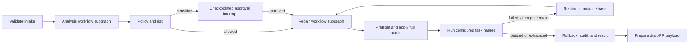

# Remediation Agent

This repository implements a Resolution/Remediation Agent for **AIOS: Agentic AI for IT Operations Support**. It is one bounded, stateful LangGraph agent that converts an evidence-supported diagnosis into a policy-checked patch, validation evidence, rollback instructions, and a draft pull-request payload.

The agent changes only disposable repository workspaces. It cannot merge, deploy, mutate production, or perform identity and privileged-access operations.

## Architecture

One parent `StateGraph` owns one agent identity and one shared `RemediationState`. Two nested graphs group analysis and repair stages; they are workflow subgraphs, not agents and have no independent goals, memory, tools, or personas.



Deterministic Python logic owns routing, policy, approvals, limits, command resolution, validation outcomes, cleanup, and final status. LLM calls return Pydantic-validated inspection requests, plans, risk observations, and full unified patches. The model never receives callable tools or command authority.

## Capabilities

- Provisional versioned Agent 2 → Agent 3 and Agent 3 → Agent 4 contracts, with exported JSON Schemas.
- Strict required JSON operator policy and deterministic repository/patch/task controls.
- Bounded repository tree, text read, and fixed-string search operations.
- Full-patch preflight, Docker workspace application, configured validation, clean-base revision, and exact attempt limits.
- Hash-bound LangGraph approval interrupts and resume through persistent checkpoints.
- Bedrock Converse, OpenAI API, and DeepSeek API structured-output adapters plus deterministic fakes.
- Encrypted PostgreSQL checkpointing; explicitly allowlisted serialization with pickle fallback disabled.
- Redacted, hash-chained JSONL audit evidence, rollback instructions, and draft-PR preparation.
- Optional GitHub draft-PR creation, disabled by both settings and policy by default. Automatic merge is not implemented.
- FastAPI start, approval, status, health, and readiness endpoints.


## Setup and quality checks

Prerequisites: Python 3.12, uv, Git, and Docker

```bash
uv sync --frozen
make lint
make format-check
make typecheck
make test
make security
make build
```

`make test` uses fake providers and in-memory checkpoints. It requires no cloud credentials, network, GitHub repository, Docker daemon, PostgreSQL, EKS, or production service.

Additional commands:

```bash
make schemas
make test-integration
make test-sandbox-integration
make sandbox-build
make docker-build
make db-up
make db-init
make db-down
```

The local Git, Docker sandbox, and PostgreSQL tests are under the `integration` marker. Docker cases skip when the
daemon or `aios-remediation-sandbox:local` image is unavailable. Run `make test-sandbox-integration` to build that
image and execute the Docker-specific suite; this command requires a running Docker daemon and may need network access
when the image is built for the first time. The PostgreSQL recreation test uses
`AIOS_TEST_POSTGRES_DSN` when set, then falls back to the local `AIOS_POSTGRES_DSN` from `.env`; it is skipped only
when neither is configured.

## Configuration

Copy `.env.example` to `.env`, fill secrets locally, and never commit it. The runtime requires:

- `AIOS_POLICY_FILE`: validated operator policy; `config/policies/reference.json` is a reference configuration, not a production default.
- `AIOS_LLM_PROVIDER`: `bedrock`, `openai`, or `deepseek`; `fake` is injection-only for automated tests.
- `AIOS_LLM_MODEL`: a provider-compatible model or Bedrock inference-profile ID.
- `AIOS_POSTGRES_DSN`: PostgreSQL checkpoint DSN.
- `AIOS_CHECKPOINT_ENCRYPTION_KEY`: exactly 16, 24, or 32 UTF-8 bytes for AES checkpoint encryption.

Bedrock also requires `AIOS_AWS_REGION` and uses the normal AWS credential provider chain. OpenAI reads `OPENAI_API_KEY`; DeepSeek reads `DEEPSEEK_API_KEY`. Provider credentials are never placed in graph state, prompts, or artifacts.

Optional GitHub draft creation requires `AIOS_GITHUB_TOKEN`, `AIOS_GITHUB_REPOSITORY=owner/repository`, `AIOS_GITHUB_WRITES_ENABLED=true`, and `github.writes_enabled=true` in the reviewed policy. Both gates must be enabled; merge is never available.

For local OpenAI API testing:

```bash
export AIOS_LLM_PROVIDER=openai
export AIOS_LLM_MODEL='<operator-selected-model-id>'
export OPENAI_API_KEY='<local-secret>'
```

For local DeepSeek API testing:

```bash
export AIOS_LLM_PROVIDER=deepseek
export AIOS_LLM_MODEL='<operator-selected-model-id>'
export DEEPSEEK_API_KEY='<local-secret>'
```

Start local persistence and the API:

```bash
make db-up
make db-init
uv run remediation-agent
```

## HTTP API

- `POST /v1/remediations`: accept `DiagnosisHandoffV1`; run until terminal state or approval interrupt.
- `POST /v1/remediations/{run_id}/approvals`: validate an exact `ApprovalDecisionV1` and resume its checkpoint.
- `GET /v1/remediations/{run_id}`: return an interrupt or final `RemediationHandoffV1`.
- `GET /healthz`: process liveness.
- `GET /readyz`: confirms runtime dependencies were constructed.

Schemas are in `config/schemas/`; run `make schemas` after changing a public contract or the policy model.

## Sandbox and policy boundary

The service never exposes a generic shell to the model. Validation task names resolve to fixed `argv` arrays in operator JSON. The Docker executor uses no shell, no network, non-root UID 10001, dropped capabilities, `no-new-privileges`, a read-only root filesystem, resource limits, one writable workspace mount with `.git` over-mounted read-only, timeouts, and streaming output caps. The approved diff is hashed before validation and checked again afterward, so a test cannot silently rewrite the proposed change. Patch and repository paths reject absolute paths, traversal, NULs, forbidden files, unsupported diff features, and symlink components.

The committed reference policy allows only the listed fixture/team repository patterns and conservative change limits. Operators must create and review a suitable policy before using another repository.

