# AIOS Remediation Agent

This service is the remediation agent for **AIOS: Agentic AI for IT Operations Support**. It takes a diagnosis from the
diagnosis agent and turns it into a policy-checked code or configuration change, with validation evidence, rollback
instructions and a draft pull request for a human reviewer and the verification agent.

The agent only changes disposable repository workspaces. It cannot merge a pull request, deploy, change production or
perform identity and privileged-access operations.

More detail lives in [docs/ARCHITECTURE.md](docs/ARCHITECTURE.md),
[docs/DEPLOYMENT_RUNBOOK.md](docs/DEPLOYMENT_RUNBOOK.md) and [docs/SECURITY_EVIDENCE.md](docs/SECURITY_EVIDENCE.md).
Results and reproduction commands for assessment are in [`docs/ASSESSMENT_EVIDENCE.md`](docs/ASSESSMENT_EVIDENCE.md),
which keeps deterministic results, the nine-trial hosted benchmark and the 18-run paired incident-memory benchmark
separate.

The operator dashboard and its public Lambda Function URL gateway are in the
[`frontend`](https://github.com/MtechSE-ArchAI-Team7/frontend) repository. The dashboard submits the diagnosis handoff
to the hosted AgentCore runtime by hand. It is a demonstration interface with no end-user authentication.

## Agent at a glance

| Property | Implementation |
|---|---|
| Identity | One `resolution-remediation-agent` |
| Orchestration | One stateful parent LangGraph workflow with analysis and repair workflow subgraphs |
| Input | Versioned `DiagnosisHandoffV1` from the diagnosis agent |
| Output | Versioned `RemediationHandoffV1` for the verification agent |
| Supported remediation | Bounded `CODE` and `CONFIGURATION` changes |
| Human-only remediation | Account unlock, password reset, access provisioning, privileged access and production changes |
| Workflow memory | In-memory checkpoints in tests, encrypted PostgreSQL locally and encrypted AgentCore Memory when hosted |
| Incident memory | Optional AgentCore semantic retrieval of bounded, validated incident summaries, used as advisory context |
| Approval | LangGraph interrupts bound to an exact plan or patch digest |
| Model providers | AWS Bedrock through `ChatBedrockConverse`, OpenAI through an IAM-authenticated AgentCore gateway, and DeepSeek |
| Execution boundary | Docker locally and isolated AgentCore Code Interpreter sessions when hosted |
| External writes | Draft-PR preparation by default. GitHub branch, push and draft creation run only when both write gates are enabled |

The workflow subgraphs are stages of one agent. They share its identity, state, checkpointer, model abstraction,
policy engine, tool boundary and final outcome.

## How the workflow runs

```mermaid
flowchart LR
    A2A["Hosted A2A 1.0 task"] --> Intake["Validate intake"]
    REST["Operator REST /v1"] --> Intake
    Intake --> Analysis["Analysis workflow subgraph"]
    Analysis --> Workspace["Create immutable-base workspace"]
    Workspace --> Memory["Retrieve advisory incident summaries"]
    Memory --> Inspect["Model ↔ GitHub MCP inspection (direct or AgentCore Gateway)"]
    Inspect --> Plan["Create structured remediation plan"]
    Plan --> Risk["Policy and risk assessment"]
    Risk -->|sensitive| Approval["Checkpointed approval interrupt"]
    Risk -->|allowed| Repair["Repair workflow subgraph"]
    Approval -->|approved| Repair
    Approval -->|rejected| Evidence["Evidence and final result"]
    Repair --> Apply["Preflight and apply full patch"]
    Apply --> Coverage["Check criterion coverage and capabilities"]
    Coverage -->|complete| Validate["Same assertions on isolated base and candidate"]
    Coverage -->|gap| Human["Human action required"]
    Human --> Evidence
    Validate -->|failed; attempts remain| Reset["Restore immutable base"]
    Reset --> Repair
    Validate -->|passed or exhausted| Evidence
    Validate -->|setup gap or no reproduction| Human
    Evidence -->|behavior demonstrated| Draft["Prepare draft-PR payload"]
    Evidence -->|blocked or failed| Cleanup
    Draft --> Cleanup["Destroy disposable workspace"]
    Cleanup --> Store["Admit eligible incident summary"]
    Store --> Artifact["Authoritative remediation handoff"]
    Artifact -. optional successful outcomes .-> Agent4["Verification agent A2A delivery"]
```



Each run goes through these steps:

1. Validate the versioned handoff, evidence references, remediation type and repository policy.
2. Create and checkpoint a disposable workspace at the immutable base commit.
3. Optionally retrieve up to three recent, high-confidence incident summaries from a host-derived repository namespace.
   They go only to the inspection prompt as untrusted hints and never count as current evidence.
4. Open a run-scoped Streamable HTTP session to GitHub's fixed MCP endpoint, either directly or through the optional
   IAM-authenticated AgentCore Gateway. Through `ToolNode`, the model calls one bounded tree, file-read, search or local
   finish tool per round.
5. Require at least one successful commit-pinned tree or file call, rebuild a typed `InspectionPlan` from the validated
   call history and close the session. Search results only locate files and are not kept as planning evidence.
6. Ask the model for a structured remediation plan and risk observations. Deterministic policy makes the final decision.
7. Pause for approval when the plan or exact patch crosses an approval boundary.
8. Ask the model for source-bound edits, build and preflight the patch, and apply it only inside the disposable workspace.
9. Build a verification contract from the diagnosis agent's acceptance criteria and select named tasks from that
   contract and operator policy, whichever test files the patch touches. Static checks never count as behavioural
   coverage. The same focused assertions run on isolated base and candidate snapshots. Every local criterion needs
   executed coverage, and at least one mapped assertion must fail on the base and pass on the candidate.
10. Evaluate the results deterministically. Missing capabilities, skipped or missing tests, setup failures,
    incompatible request contracts and unreproduced diagnoses return `HUMAN_ACTION_REQUIRED`. Assertion failures and
    ordinary Git applicability mismatches share one bounded repair budget, restart from the immutable base and stop at
    the configured limit. Applicability retries never relax patch anchoring with `--unidiff-zero`.
11. Produce rollback guidance, audit events, artifacts and a draft-PR payload. Optionally create and verify a GitHub
    draft through host-controlled MCP. Cleanup is always attempted.
12. After successful cleanup, optionally store a bounded `AUTO_VALIDATED` incident summary when both write gates allow
    it. A storage failure never changes a successful result.

The model never decides whether validation passed, lowers a policy severity, supplies an executable command or calls
workspace, sandbox, Git, GitHub, artifact, approval, checkpoint, credential or cleanup operations.

## Executable diagnosis and durable delivery

The operator registry in `adapters/validation_assets/profiles.json` defines the supported behaviours for each repository
and profile. Before plan approval, the host compiles canonical assertion IDs and request contracts, checks that the
source evidence is complete and runs base startup, fixture and cleanup checks. Paraphrased criteria and JSON formatting
are not treated as identities. One bounded planning correction can repair mappings. An unresolved implementation
requirement returns `HUMAN_ACTION_REQUIRED` before any patch is generated.

Source views keep expressions such as `token: userToken`, while real secret values sit in protected source locations.
The model returns an `EditProposal` with the inspected file's digest, an exact line range, the expected visible bytes and
the replacement. The host rejects stale, uninspected, overlapping or protected edits, builds the diff and checks that it
applies before approval. Each candidate gets three edit proposals, and a run gets three executed candidate attempts.
Infrastructure failures go to recovery and never use up a repair attempt. The overall invocation deadline still bounds
the workflow, and inspection is capped at 14 rounds and 16 calls so it can cover the whole affected path.

Approvals bind the workflow version, immutable base, contract, policy, assertions and assets, and candidate scope.
Unfinished checkpoints without compatible evidence need a new run. The accepted, redacted diagnosis handoff is kept as
`diagnosis-handoff.json`. Operator replay must use that exact artifact or the diagnosis agent's own delivery, never
criteria rebuilt from a summary.

Validated evidence is saved before the checkpointed branch, commit, push, draft and verification stages. Every stage
checks the candidate tree and an unchanged target base, and remote writes never force-push or silently rebase. A lost
GitHub response is reconciled against the exact repository, branch, commit and open draft, with three bounded attempts
before a publication failure is reported. `DRAFT_PR_PREPARED` counts as success only in explicitly configured no-write
qualification. When remote delivery is configured, success needs a confirmed draft. Memory admission needs durable
evidence and cleanup, and delivery to the verification agent also needs the verified draft references.

An operator can retry an unchanged validated publication through `POST /v1/remediations/{run_id}/publication-retry`
with `PublicationRetryRequestV1`, or with the A2A `application/vnd.aios.publication-retry.v1+json` message on the same
task. Stale candidate digests or execution inputs are rejected. See
[workflow qualification and recovery](docs/WORKFLOW_QUALIFICATION.md).

## Behavioural verification and the verification handoff

The diagnosis agent's `DiagnosisHandoffV1` supplies the diagnosis, evidence and acceptance criteria. The remediation
agent never pulls Jira content to define its tests. Criterion IDs combine position and a content digest (`AC-01-…`), and
the structured plan maps every criterion exactly once. `LOCAL` is the default. `POST_DEPLOYMENT` needs an explicit
reason and plan approval, stays pending in the brief and never counts as a local pass. At least one local reproduction is
required. Missing task mappings, request contracts, inspected paths or executable capabilities block the run rather than
invent an endpoint or narrow the scope. Other missing or contradictory plan details force exact-plan approval and stay
visible in the verification brief and pull request as unresolved risks.

Operator task metadata separates `STATIC` from `BEHAVIORAL` tasks. Behavioural tasks use a fixed `pytest`, `node_test`,
`ecommerce_checkout` or `ecommerce_purchase` profile, explicit test paths or IDs, and any required inspection paths and
request contract. The host builds the runner arguments, and the capabilities shown to the model leave out executable
argv and environment values. The contract, pinned source evidence, base SHA and capabilities reach the planning, risk,
patch and revision stages. Tests changed by a patch still need exact-diff approval, and regression assertion digests
cannot change during a repair loop.

Unknown tasks, missing, zero or skipped tests, malformed reports, setup or import errors, unsupported dependencies,
inconsistent test identities and failed cleanup cannot qualify. Reports come from the executor and trusted reporters. A
base and candidate that both pass do not reproduce the defect. Genuine candidate assertion failures enter the clean-base
repair loop, and running out of attempts returns `VALIDATION_FAILED`. Blocked and exhausted runs keep their patch and
failure evidence and clean up without preparing a pull request or storing incident memory. Completed v1 records stay
readable, and an older in-flight run without behavioural evidence cannot use its earlier validation pass.

`verification-brief.json` is exported as `VerificationBriefV1` and linked through the digest-verified artifact manifest.
It records every criterion, request examples and fixtures, base and candidate reports, assertion and dependency digests,
limitations, unresolved risks and the checks left for the verification agent. A readable copy appears in the pull
request. Observations separate fixed assertions, introduced regressions and baseline failures. Risk approval is recorded
separately and never erases findings. Unrelated header or cookie findings do not widen the patch, while mandatory
operator security tasks still apply. Both v1 handoff wire formats are unchanged.

Every run also emits `release-provenance.json` as `ReleaseProvenanceV1`. Local runs are labelled as local. A hosted run
must resolve exactly one immutable AgentCore version whose release ID, source SHA, image digest, image URI, account and
Region match the running container before it creates a workspace. Missing or ambiguous provenance returns
`HUMAN_ACTION_REQUIRED`, which blocks the pull request and incident memory. Checkpoints interrupted before provenance
existed need a new run.

### Offline e-commerce profiles and qualification

The e-commerce profiles run the repository's real application, with its Express middleware, initialisation SQL and
native sqlite3 driver, over loopback. `ecommerce_checkout` runs nine fixed server and storefront browser checks: durable
insertion, server-priced multi-product totals, invalid carts, rejected writes, restart persistence, confirmed browser
success, HTTP and network failures, and catalog regression. It uses offline Playwright and Chromium with no
candidate-only exports or test hooks, and does not require a particular order-status literal. `ecommerce_purchase` runs
the operator-owned purchase suite with a fresh disposable `ecommerce.db` for each case. The purchase profile requires
inspection of `server.js`, `schema.sql`, `seed.sql`, `public/app.js` and `package.json`. Its contract is **POST
`/purchase`** with `application/json`, a safe-integer `productId` and a positive safe-integer `quantity`. It rejects
string fields and form encoding. `/checkout` is a different route. If the diagnosis agent needs a different contract,
add and review a matching operator profile rather than change the expectations.

Eight fixed purchase cases cover stock below, equal to and above the request, invalid and malformed inputs, form
rejection, unknown products, persisted decrements, restart persistence and concurrent purchases without overselling.
Existing response shapes are asserted. Fixtures start product 1 at stock 10 and run only in disposable copies, and
databases and logs never enter the reviewed diff. Child process groups are terminated on timeout, container and session
cleanup is required, and source, test and runner digests are checked. Docker mounts the behavioural source and trusted
assets read-only, and only temporary fixture files are writable. Resource limits, non-root execution, no external
network, credential exclusion and output caps all apply.

Dependencies resolve **only at operator build time**, from `validation/ecommerce/package-lock.json`. The build packages
Node and native dependencies, seals every file in a manifest and smoke-loads Express, sqlite3 and bcrypt. Before
execution the runtime checks the platform and every file digest. A mismatched ABI or library, a missing asset, an
unexpected file or a startup failure becomes a capability gap. No packages are installed and there is no syntax-only
fallback during a run.

```bash
make test-sandbox-integration  # builds image/bundle; qualifies checkout and purchase through real Express/SQLite
# Explicitly opt-in, with operator credentials and an already-built compatible Linux bundle:
AIOS_AWS_REGION=ap-southeast-1 AIOS_BEHAVIORAL_BUNDLE=/path/to/qualified/bundle make test-code-interpreter-live
```

The hosted image packages a separate Linux/arm64 dependency bundle for Code Interpreter, independent of the AgentCore
Runtime architecture. Every release qualifies that exact bundle, browser included, in the managed
`aws.codeinterpreter.v1` environment in `ap-southeast-1`. `CODE_INTERPRETER_PLATFORM` can be overridden at image build
time once the new platform is qualified in the target environment, and the runtime platform and file-digest checks fail
closed on drift. The live qualification is excluded from the default tests.
[AWS's preinstalled libraries](https://docs.aws.amazon.com/bedrock-agentcore/latest/devguide/code-interpreter-preinstalled-libraries.html)
do not include Express or sqlite3, which is why the native dependencies are packaged. Code Interpreter's managed isolation
allows limited AWS-service networking, unlike Docker's `--network none`, so only the system interpreter is qualified.
Never attach production resources or credentials to validation.

Generated tests are reviewable, untrusted code. Structured reporting proves that tests ran and reproduced the defect,
and the operator-owned purchase and checkout assertions supply independent coverage. The demo application's legacy
dependency versions are pinned for compatibility. Upgrading them or fixing unrelated security findings is a separate
change.

## Tools and capabilities

The model can call far less than the agent can do. Repository inspection uses three read-only MCP tools, and every
change is a deterministic workflow action behind a typed port.

The versioned catalogue lists **17 tools**: four that the model can call for inspection and control, and thirteen that
only the workflow calls. `GET /v1/tools` returns the same metadata used to generate
[`docs/TOOL_CATALOG.md`](docs/TOOL_CATALOG.md): each tool's typed boundary, authority, availability gate, description,
model-visible argument names and safety controls. The catalogue response is version `1.1`, and the frontend keeps a
versioned snapshot of it that is updated with catalogue changes.

| Capability | Typed boundary | Implementation and controls |
|---|---|---|
| Repository inspection | `InspectionToolProvider` / `RepositoryInspectionPort` | `GitHubRemoteMcpInspectionTools` connects directly by default, and `AgentCoreGatewayInspectionTools` optionally signs the derived `/mcp` Gateway endpoint with fresh SigV4 credentials. Both expose the same three native tools with repository identity, immutable SHA, path, search, schema, redaction, output and call-budget controls. `get_file_contents` requires the assigned commit in `sha` and rejects `ref`. |
| Workspace and Git | `RepositoryWorkspacePort` | `LocalGitRepository` creates the immutable-base workspace and runs diff, branch, commit and push with fixed argument arrays. The model cannot call these. |
| Patch and validation | `SandboxExecutor` | `DockerSandboxExecutor` runs locally. `AgentCoreCodeInterpreterSandbox` keeps the patch boundary and validates a sanitised copy in an isolated managed session. |
| Structured model inference | `StructuredModel` | Provider adapters normalise one inspection tool call per turn and return Pydantic-validated plan, risk, patch and revision objects with bounded retries and recorded metadata. OpenAI structured stages always use function calling. |
| Release provenance | `ReleaseProvenancePort` | Local runs are labelled. Hosted runs use bounded read-only AgentCore control-plane calls to match the running release before touching the repository. |
| Pull requests | `PullRequestProvider` | A deterministic draft payload is prepared only after qualifying behavioural evidence. Authenticated GitHub draft creation has its own gate, and merge is not available. |
| Evidence and audit | `ArtifactStore`, `ArtifactReader`, `AuditSink` | Local files or immutable digest-addressed S3 objects hold redacted artifacts and hash-chained audit events. Preview reads are manifest-selected, session-scoped, bounded and digest-verified. |
| Resume and approval state | LangGraph checkpointer | Interrupt state is keyed by the run UUID and encrypted before it is written to PostgreSQL or AgentCore Memory. |
| Advisory incident history | `IncidentMemoryPort` | Disabled, fake and AgentCore adapters retrieve and store bounded summaries in a host-derived namespace. The model cannot call it, and it cannot change policy, validation or evidence. |

The reference policy defines these validation task names:

| Task name | Reference command purpose |
|---|---|
| `unit_tests` | Run the target repository's pytest suite |
| `integration_tests` | Run tests marked `integration` |
| `lint` | Run Ruff checks |
| `type_check` | Run mypy |
| `security_scan` | Run Bandit against `src` |
| `config_validation` | Validate the demonstration JSON configuration |

These are examples in `config/policies/reference.json`. An operator reviews the policy, and the model can only suggest
task names. The policy engine keeps known names, adds mandatory tasks for the changed paths and resolves each name to a
trusted `argv` array.

### Model-called tools

The analysis stage binds exactly four LangChain tools to the model:

- `get_repository_tree(owner, repo, tree_sha, recursive, path_filter)`
- `get_file_contents(owner, repo, path, sha, fields)`
- `search_code(query, sort, order, fields, page, perPage)`
- `finish_inspection(rationale)`

The first three are discovered from `https://api.githubcopilot.com/mcp/` through `langchain-mcp-adapters` and keep their
native GitHub names and schemas. Discovery must return exactly this allowlist with compatible security-critical
arguments. `finish_inspection` is a local LangChain `@tool` with no repository authority. The model makes exactly one call
per round and cannot finish until a commit-pinned tree or file read has succeeded. `search_code` searches the default
branch, so it only locates candidate paths for a later pinned file read.

Planning, risk, patch and revision use `with_structured_output(...)`. Clone, checkout, diff, patch application,
validation, branch, commit, push, draft PR, artifacts, approvals and cleanup are not tools, because they have side effects
or decide security outcomes and so stay under deterministic workflow control.

### Why MCP is limited to inspection

GitHub hosts the endpoint. See its
[remote-server documentation](https://github.com/github/github-mcp-server/blob/main/docs/remote-server.md) and
[setup guidance](https://docs.github.com/en/copilot/how-tos/provide-context/use-mcp-in-your-ide/set-up-the-github-mcp-server).
GitHub's authentication, API limits, availability and feature entitlements apply.

The hosted MCP adapter is created for one run. It receives the validated repository reference, disposable workspace,
immutable base commit, token and operator policy from the host process. It connects only to the fixed HTTPS endpoint,
with certificate verification on, redirects and ambient proxy settings off, and the headers `X-MCP-Tools`,
`X-MCP-Readonly: true` and `X-MCP-Lockdown: true`. The model never sees the bearer token.

Every native call is rebound to the handoff's exact `https://github.com/{owner}/{repo}.git` target. Tree and file calls
must use the cloned base commit, and mutable `ref` reads are denied. Search must carry exactly the matching
`repo:owner/repo` qualifier. Host checks also reject traversal, forbidden or secret paths, binary or external-resource
content, symlinks, submodules, unexpected response shapes and policy-limit violations. Missing tools or incompatible
schema changes on GitHub's side fail closed.

Provider messages and the MCP session are transient. Checkpoints keep only typed redacted artifacts, normalised call
records and digests, model metadata and the rebuilt inspection plan. Generic filesystem or shell MCP servers, arbitrary
server commands, URLs, redirects and tool allowlists are not accepted. The hosted MCP connection is an infrastructure
boundary inside the same workflow.

The runtime pins MCP SDK v1 (`mcp>=1.30.0,<2`) with `langchain-mcp-adapters>=0.3.1,<0.4` until the adapter's
[MCP SDK v2 compatibility issue](https://github.com/langchain-ai/langchain-mcp-adapters/issues/578) is resolved.

## Model providers

Model and provider IDs are operator settings, so no current model name is hard-coded. The chosen provider and model must
support both structured output and tool calling through their LangChain adapter.

| `AIOS_LLM_PROVIDER` | Adapter | Intended use | Additional configuration |
|---|---|---|---|
| `bedrock` | `langchain_aws.ChatBedrockConverse` | Deployment target and local fallback | `AIOS_LLM_MODEL` and `AIOS_AWS_REGION`, with the AWS credential provider chain |
| `openai` | `langchain_openai.ChatOpenAI` | AgentCore IAM gateway, or direct mode for local work and rollback | `AIOS_LLM_MODEL`, then choose `AIOS_OPENAI_AUTH_MODE` and set either the AWS Region and gateway ARN or an API key or secret ARN |
| `deepseek` | `langchain_deepseek.ChatDeepSeek` | Optional local experiments | `AIOS_LLM_MODEL`, `DEEPSEEK_API_KEY` and optional `AIOS_DEEPSEEK_BASE_URL` |
| `fake` | `FakeStructuredModel` | Unit, graph, security and demonstration tests | Injection only, and rejected by the production dependency builder |

Every live adapter records the provider and model, prompt version, latency, token usage where available, refusal state,
response digests and an optional bounded reasoning summary. Failed structured calls record only a normalised error code,
HTTP status, parameter name, retryability and digests. Provider bodies, headers and request IDs are left out. OpenAI does
not expose raw reasoning tokens, and the UI labels reasoning summaries separately from schema-validated decision
rationales. Credentials, prompts, repository contents and raw provider responses are never recorded.

## Repository structure

```text
remediation-agent/
├── README.md                       # Primary operator and contributor guide
├── openapi.yaml                    # Generated and version-controlled HTTP contract
├── pyproject.toml                  # Python package, dependencies, and tool configuration
├── uv.lock                         # Reproducible dependency lock
├── Makefile                        # Development, test, schema, build, and lifecycle commands
├── .env.example                    # Safe configuration variable names/placeholders
├── compose.yaml                    # Local PostgreSQL checkpoint store
├── Dockerfile                      # API service image
├── docker/
│   └── sandbox.Dockerfile          # Separate restricted validation image
├── docs/
│   └── TOOL_CATALOG.md             # Generated 17-tool catalogue and authority boundary
├── config/
│   ├── policies/
│   │   └── reference.json          # Reviewed reference policy and explicit limits
│   └── schemas/                    # Generated handoff and policy JSON Schemas
├── scripts/
│   ├── export_schemas.py           # Regenerates versioned JSON Schemas
│   ├── export_openapi.py           # Regenerates openapi.yaml from FastAPI
│   └── export_tool_catalog.py       # Regenerates the assessment-facing tool catalogue
├── src/remediation_agent/
│   ├── api/
│   │   ├── app.py                  # FastAPI routes and production dependency lifecycle
│   │   ├── models.py               # HTTP-only response and error envelopes
│   │   └── openapi.py              # Tags and representative safe API examples
│   ├── workflow/
│   │   ├── graph.py                # Parent graph, workflow subgraphs, and deterministic routes
│   │   ├── nodes.py                # Dependency-injected workflow stages and side-effect sequencing
│   │   └── state.py                # Shared typed LangGraph state
│   ├── domain/
│   │   ├── enums.py                # Routing, status, risk, approval, and outcome enums
│   │   └── models.py               # Strict domain models and versioned inter-agent handoffs
│   ├── policy/
│   │   ├── models.py               # Strict operator-policy schema
│   │   ├── loader.py               # Required JSON policy loading and validation
│   │   └── engine.py               # Repository, plan, path, patch, limit, and task decisions
│   ├── ports/
│   │   ├── protocols.py            # Narrow model, repository, sandbox, PR, artifact, and audit interfaces
│   │   └── models.py               # Typed requests/results crossing infrastructure boundaries
│   ├── adapters/
│   │   ├── models.py               # Bedrock, OpenAI, and DeepSeek structured/tool-call adapters
│   │   ├── mcp.py                  # Fixed GitHub hosted MCP client, scoping, and schema validation
│   │   ├── repository.py           # Bounded local Git workspace implementation
│   │   ├── sandbox.py              # Restricted Docker patch/validation implementation
│   │   ├── checkpoint.py           # Encrypted in-memory/PostgreSQL checkpoint support
│   │   ├── pr.py                   # Draft-PR preparation and optional GitHub creation
│   │   ├── evidence.py             # Redaction, artifacts, and hash-chained audit evidence
│   │   └── fakes.py                # External-service-free deterministic test adapters
│   ├── tools/
│   │   ├── catalog.py              # Typed inventory of all 17 operational tools
│   │   └── inspection.py           # Local finish_inspection control tool
│   ├── prompts/
│   │   └── templates.py            # Versioned structured-output instructions
│   ├── config.py                   # Environment-backed runtime settings
│   ├── db.py                       # PostgreSQL checkpoint schema initialization
│   ├── service.py                  # Start/get/approve lifecycle around the compiled graph
│   └── main.py                     # Uvicorn process entry point
└── tests/
    ├── api/                         # HTTP behavior and OpenAPI contract tests
    ├── unit/                        # Deterministic component tests
    ├── graph/                       # Routes, retries, approvals, and one-agent invariants
    ├── mcp/                         # Hosted-transport fixtures, contract, and opt-in live tests
    ├── security/                    # Policy, injection, path, secret, and patch controls
    └── integration/                 # Opt-in Git, Docker, and PostgreSQL tests
```

Package `__init__.py` files, `py.typed`, caches and fixture details are left out of the tree.

## Quick start

You need Python 3.12, [uv](https://docs.astral.sh/uv/), Git and Docker.

```bash
cd remediation-agent
cp .env.example .env
uv sync --frozen
make sandbox-build
make db-up
make db-init
uv run remediation-agent
```

Before starting the service, set the local PostgreSQL password or DSN, checkpoint encryption key, reviewed policy path,
model-provider settings and `AIOS_GITHUB_TOKEN` in `.env`. Never commit that file or put credentials in policy JSON.

The service listens on `http://127.0.0.1:8080`. The API documentation is at:

- Swagger UI: `http://127.0.0.1:8080/docs`
- ReDoc: `http://127.0.0.1:8080/redoc`
- Live JSON contract: `http://127.0.0.1:8080/openapi.json`
- Committed YAML contract: `openapi.yaml`

## Configuration

The runtime refuses to start when a required setting is missing.

| Setting | Purpose |
|---|---|
| `AIOS_POLICY_FILE` | Required reviewed operator policy. `config/policies/reference.json` is an example |
| `AIOS_LLM_PROVIDER` | `bedrock`, `openai` or `deepseek`. `fake` is for test injection only |
| `AIOS_LLM_MODEL` | Provider-compatible model or Bedrock inference-profile ID |
| `AIOS_AWS_REGION` | Required for Bedrock and OpenAI IAM-gateway mode |
| `AIOS_INSPECTION_MCP_MODE` | `github_direct` by default, or `agentcore_gateway` for the optional shared inspection Gateway |
| `AIOS_INSPECTION_GATEWAY_ARN` | Required only in inspection Gateway mode. The regional HTTPS `/mcp` endpoint is derived from this ARN |
| `AIOS_OPENAI_AUTH_MODE` | `api_key` by default, or `aws_iam_gateway` for the authenticated AgentCore gateway |
| `AIOS_OPENAI_GATEWAY_ARN` | Required only in IAM-gateway mode. The HTTPS inference URL is derived from this ARN |
| `OPENAI_API_KEY`, `AIOS_OPENAI_SECRET_ARN` | Direct OpenAI credential for local development or hosted rollback. Not allowed in IAM-gateway mode |
| `AIOS_OPENAI_BASE_URL` | Optional, direct API-key mode only. Arbitrary base URLs are not allowed in IAM-gateway mode |
| `DEEPSEEK_API_KEY` | Credential for the optional local DeepSeek adapter |
| `AIOS_POSTGRES_DSN` | PostgreSQL checkpoint DSN |
| `AIOS_CHECKPOINT_ENCRYPTION_KEY` | Exactly 16, 24 or 32 UTF-8 bytes for AES checkpoint encryption |
| `AIOS_BEHAVIORAL_BUNDLE` | Sealed offline native dependency directory. Local default `.artifacts/validation/ecommerce`, hosted image `/app/validation/ecommerce` |
| `AIOS_SANDBOX_IMAGE` | Restricted validation image. Defaults to `aios-remediation-sandbox:local` |
| `AIOS_GITHUB_WRITES_ENABLED` | Application-side gate for branch, push and draft creation. Defaults to `false` |
| `AIOS_GITHUB_REPOSITORY` | Required `owner/repository` target when GitHub writes are enabled. It must match the handoff URL |
| `AIOS_GITHUB_TOKEN` | Production bearer token for hosted MCP inspection and HTTPS clone, also used for optional push and draft creation |

The reference policy also requires `max_inspection_rounds`, `max_inspection_tool_calls` and
`max_mcp_tool_timeout_seconds`, set to 14 rounds, 16 calls and 30 seconds. Requests and model output cannot change
these limits or choose a different MCP server.

Production accepts only canonical `https://github.com/{owner}/{repo}.git` handoffs. `LOCAL`, GitLab, generic Git and
credential-bearing URLs fail intake validation before a workspace is created. The shared v1 handoff schema is unchanged,
so the other agents stay wire-compatible.

### Draft publication through GitHub MCP

Draft publication uses its own direct Streamable HTTP session to GitHub's hosted MCP endpoint, even when inspection
uses AgentCore Gateway. The host can call only `list_pull_requests`, `create_pull_request` and `pull_request_read`
(`method=get`), and these tools are never given to the model. There is no REST fallback. Branch, commit and push stay
trusted Git operations, and the MCP timeout policy also bounds publication calls.

Readiness checks discovery and repository read access. Git push and MCP draft creation are the real permission checks.
Discovery drift, oversized or invalid responses and mismatched remote evidence fail closed. Creation forces draft mode,
treats the returned URL only as a locator and re-reads the pull request to confirm its repository, branches, exact head
and base SHAs, open and unmerged state and draft flag. A lost response is reconciled before any repeat create.
Publication failures keep the candidate with `HUMAN_ACTION_REQUIRED` so the operator can retry the exact publication.
Audit events include redacted MCP operation and outcome records and digests, including interrupted creation attempts.
`make test-mcp-live` includes read-only publication discovery, list and read checks and never creates a pull request.

GitHub creation also needs `github.writes_enabled=true` in the reviewed policy, so both gates must be on. The Git adapter
passes the token only through a trusted askpass process for exact-host `https://github.com` remotes. It never puts
credentials in URLs, argv, workflow state, checkpoints, model input, artifacts or validation containers. For
inspection-only deployments, grant only the repository read access needed for MCP and cloning, and add Contents and Pull
Requests write permission only when draft writes are enabled. There is no automatic merge.

`config/policies/demo.json` is write-enabled and scoped to the Team 7 buggy e-commerce demo repository only. The
reference policy is GitHub-only and write-disabled, which makes it the safer starting point for other operators.

## Buggy e-commerce demonstration

The dashboard preloads a `DiagnosisHandoffV1` for the deployed division-by-zero defect in
`MtechSE-ArchAI-Team7/buggy-ecommerce-demo`. The handoff is pinned to the commit currently deployed on Elastic
Beanstalk, and the deployment URL is only upstream evidence. The remediation agent never deploys to or changes that
environment.

The demo policies allow autonomous changes only to `server.js`, `public/app.js`, dependency-free helpers under `lib/`
and tests under `tests/`. The division-by-zero contract selects `node --check server.js` and
`node --test tests/calculate-average.test.js`, with no network access or package installation. The expected fix moves the
average calculation into dependency-free logic, returns a typed client error for a zero divisor, keeps valid division
working and adds a built-in `node:test` regression file. Package manifests need approval.

Hosted validation records show the execution boundary without exposing the session. Each task records the
`AGENTCORE_CODE_INTERPRETER` backend, executor identifier, workspace and input digest, a one-way session digest, enforced
controls, outcome, duration and cleanup status, and every operator-owned task gets a fresh managed session. AWS documents
JavaScript execution in its
[runtime selection guide](https://docs.aws.amazon.com/bedrock-agentcore/latest/devguide/code-interpreter-runtime-selection.html)
and lists bundled Node.js libraries in the
[pre-installed library reference](https://docs.aws.amazon.com/bedrock-agentcore/latest/devguide/code-interpreter-preinstalled-libraries.html).
This scenario uses only built-in Node features and downloads nothing during validation.

Starting the preloaded run may create a branch and draft pull request when both the runtime and policy write gates are
on. It never merges or deploys. Loading the UI, testing provider connectivity or deploying the agent does not submit the
handoff or write to the target repository.

## HTTP API

| Method and path | Operation ID | Behaviour |
|---|---|---|
| `GET /` | `get_service_info` | Return service identity and architecture |
| `GET /healthz` | `get_health` | Process liveness |
| `GET /readyz` | `get_readiness` | Runtime and checkpoint readiness. Returns `503` when unavailable |
| `GET /v1/tools` | `list_operational_tools` | Return the versioned 17-tool catalogue without invoking any tool |
| `POST /v1/remediations` | `start_remediation` | Accept `DiagnosisHandoffV1` and return `202` at completion or at an approval interrupt |
| `GET /v1/remediations/{run_id}` | `get_remediation` | Return the latest persisted `RemediationRunView`, or `404` when absent |
| `POST /v1/remediations/{run_id}/approvals` | `submit_remediation_approval` | Resume with an exact `ApprovalDecisionV1`. Returns `404` or `409` on mismatch |

Start a run with a payload that matches `config/schemas/diagnosis-handoff-v1.schema.json`:

```bash
curl --request POST http://127.0.0.1:8080/v1/remediations \
  --header 'Content-Type: application/json' \
  --data @diagnosis-handoff.json
```

Every accepted start returns a run UUID. A `202` response does not mean the workflow finished, so check `status`. When
it is `AWAITING_APPROVAL`, copy the exact `approval_id` and `scope_digest` into a reviewed decision:

```bash
curl --request POST http://127.0.0.1:8080/v1/remediations/4d1ceef7-9dd5-47d0-b875-218e1682a8d7/approvals \
  --header 'Content-Type: application/json' \
  --data '{
    "schema_version": "1.0",
    "approval_id": "approval-7dd19b23",
    "scope_digest": "sha256:ecb7689fbcc1d65d6f1e7509f9e5f3f6d7e46fd26978c94443a2f45a0a765a4c",
    "status": "APPROVED",
    "reviewer_id": "operator@example.org",
    "decided_at": "2026-08-08T09:30:00Z",
    "comment": "Reviewed against the evidence and policy findings."
  }'
```

Poll `GET /v1/remediations/{run_id}` for the latest interrupted or terminal view. Only hand a terminal, non-null
`result` to the verification agent. The field-level integration guide is `config/schemas/CONTRACTS_README.md`.

### Regenerating API and handoff contracts

FastAPI is the source of truth for the HTTP contract, and the checked-in YAML must match `create_app().openapi()`:

```bash
make openapi
```

The typed tool catalogue is the source of truth for the tool documentation:

```bash
make tool-catalog
```

Pydantic models are the source of truth for the versioned handoff and policy JSON Schemas:

```bash
make schemas
```

Run the matching command after changing an API route, response model, example, tool descriptor, handoff or policy
model. The default test suite checks the OpenAPI contract and tool catalogue for drift.

## Evaluation

### Scripted benchmark

`config/evaluation/suite-v2.json` defines ten deterministic cases against one immutable `buggy-ecommerce-demo` commit.
They cover autonomous repair, protected-path approval, adaptive inspection, clean-base revision, a contradicted
diagnosis, repository prompt injection, denied secret access, unsafe-remediation denial, unsupported tools and
dependency approval. Handoffs and scripted fixtures live under `config/evaluation/`, and the target repository is
read-only. The default benchmark needs no credentials and is repeatable:

```bash
make evaluate
make assessment-report
```

`make evaluate-hosted` is opt-in. It runs cases 01, 06 and 08 three times each with the configured model, GitHub MCP, an
immutable clone and AgentCore Code Interpreter. Model-quality failures are recorded as results, while runner or
artifact-integrity failures stop the command. Both GitHub write gates are forced off.

`make evaluate-judge` scores a completed hosted artifact without rerunning remediation. It needs explicit
`AIOS_EVAL_JUDGE_PROVIDER`, `AIOS_EVAL_JUDGE_MODEL` and `AIOS_EVAL_JUDGE_PROMPT_VERSION` settings and rejects reusing the
candidate provider and model. The judge sees only a sanitised evidence bundle, has no tools and does not gate anything.
Missing hosted or judge artifacts show as `NOT RUN` in the generated report.

### Incident memory and paired evaluation

Checkpoints and incident memory solve different problems. Checkpoints are authoritative for run state, approval resume
and recovery. Optional AgentCore semantic memory holds only bounded summaries of validated, cleaned-up incidents.
Retrieval is limited to a host-derived repository namespace, three matches, a score of at least `0.70`, an age of at most
`30` days, 8 KiB of combined context and a five-second timeout. Retrieved text is untrusted and reaches only the
inspection prompt, and the workflow still requires current-commit tree or file evidence. Memory cannot add tools,
authorise a path, lower policy, choose validation or reuse an old patch.

Configure a dedicated existing AgentCore memory resource. The service never creates or changes it:

```text
AIOS_INCIDENT_MEMORY_ENABLED=false
AIOS_INCIDENT_MEMORY_WRITES_ENABLED=false
AIOS_INCIDENT_MEMORY_ID=<dedicated-incident-memory-id>
AIOS_INCIDENT_MEMORY_STRATEGY_ID=<semantic-strategy-id>
AIOS_INCIDENT_MEMORY_NAMESPACE=/aios/incidents/
```

Writes also need `incident_memory.writes_enabled=true` in operator policy. Runtime records are labelled
`AUTO_VALIDATED` and exclude source, patches, prompts, task output, credentials, environment values, approval content and
run or session identifiers. Evaluation seeds are labelled `EVALUATION_SEED` and need an explicit passed artifact:

```bash
AIOS_MEMORY_SEED_ARTIFACT=.artifacts/evaluation/hosted/suite-v2.json make memory-seed
make evaluate-memory
make evaluate-memory-hosted   # 18 sequential live runs; opt-in
make evaluate-memory-judge    # post hoc and non-gating
make assessment-report
```

The paired benchmark runs hosted cases 01, 06 and 08 as three counterbalanced off and on pairs per case. Writes are
forced off in both arms so the arms cannot contaminate each other. The report shows each arm and the observed
differences.

### Live-model campaigns

The live campaigns run repeated trials with the configured gateway model on disposable synthetic repositories with
restricted Docker validation. They include a functional group and a five-family attack corpus across four input surfaces
(diagnosis, repository content, tool results and memory). Inspection and injected memory are local fixtures, and GitHub
publication and verification delivery are off. Run a budgeted campaign from this directory:

```bash
AIOS_RUN_GAP_CAMPAIGN=1 uv run python -m scripts.run_gap_campaign \
  --campaign-id unique-functional-id --group functional \
  --budget-usd 25 --output .artifacts/campaigns/unique-functional-id
```

Use `--group attacks` for three repetitions of each of the 20 attack combinations. `--group followup` adds five Python
baseline trials to the attack matrix. Optional `--shard-index` and `--shard-count` split cases across shards. Give each
shard its own budget, because the journal enforces each manifest's ceiling, not an account-wide one. The example rates of
US$10 per million input tokens and US$60 per million output tokens are planning estimates. Each trial reserves its maximum
cost before it runs, unknown usage keeps that reservation, and cloud infrastructure costs are not included.

Keep the manifest, journal, report and evidence together, and resume with the same arguments and unchanged code.
Completed or interrupted trials are never silently replayed, so record corrected fixtures as a new campaign.
`scripts/adjudicate_gap_campaign.py` applies the prepared-draft scoring correction as a separate adjudication without
replacing the original results. Reports keep failed cohorts and per-case denominators, latency, tokens and small-sample
intervals.

`config/evaluation/gap-closure-criteria.json` maps all 18 accepted purchase and checkout assertions, and its tests also
flag business requirements outside the current checkout contract.

## Quality and test commands

```bash
uv sync --frozen
make lint
make format-check
make typecheck
make test
make test-model-live
make test-mcp
make test-mcp-live
make test-code-interpreter-live
make security
make build
```

`make test` uses fake providers, an in-process GitHub-shaped MCP fixture and in-memory checkpoints. It needs no cloud
credentials, network access, GitHub repository, Docker daemon, PostgreSQL, EKS or deployed service. `make test-mcp` runs
the focused discovery, Streamable HTTP lifecycle, contract and security suite.

The live tests are opt-in and never run in the default suite:

- `make test-model-live` uses the AWS credential provider chain and makes one bounded structured request through the
  configured gateway.
- `make test-mcp-live` needs `AIOS_GITHUB_TOKEN`, `AIOS_LIVE_GITHUB_MCP_REPOSITORY_URL` and
  `AIOS_LIVE_GITHUB_MCP_COMMIT_SHA` for an immutable public fixture.
- `make test-tool-gateway-live` uses the same repository and commit variables plus `AIOS_INSPECTION_GATEWAY_ARN`. It
  signs with the AWS credential provider chain, requires the Gateway to expose exactly three tools and calls each one.
- `make test-code-interpreter-live` runs harmless `node --check` and built-in `node:test` commands in fresh Code
  Interpreter sessions and checks the backend, hashed-session evidence and cleanup.

The opt-in integration and image commands are:

```bash
make test-integration
make test-sandbox-integration
make sandbox-build
make docker-build
make agentcore-docker-build
make db-up
make db-init
make db-down
```

Docker tests skip when the daemon or the `aios-remediation-sandbox:local` image is unavailable. The PostgreSQL recreation
test uses `AIOS_TEST_POSTGRES_DSN` when set, then the local `AIOS_POSTGRES_DSN`, and skips when neither is configured.

## CI/CD pipeline

`.github/workflows/checks.yaml` and `.github/workflows/build-scan-image.yaml` own the release gates. Every pull request
and push to `main` runs Ruff, strict mypy, workflow linting, the package build, the credential-free default suite, the
deterministic benchmark, PostgreSQL, Docker and browser integration, Bandit and pip-audit. Integration setup must succeed
and no integration test may be skipped. Unit and integration coverage are combined with branch measurement, and the
service package must reach **90%**. The same run measures operator scripts and sends the full source report to Sonar for
its new-code coverage gate.

Trusted runs also need the SonarQube quality gate, Snyk Code and Snyk Open Source scans of the locked Python and bundled
Node dependencies. Reports keep every severity, and any HIGH or CRITICAL finding or scanner error blocks the release.
Fork and Dependabot pull requests run the credential-free checks without scanner secrets, while `main` always runs the
full scanner gate. No scanner finding is suppressed in repository policy.

The runtime image uses a digest-pinned Wolfi base with Python 3.12, Git and a fixed non-root UID. Once the checks pass,
the pipeline builds the `linux/arm64` image once and keeps a SHA-256-verified Docker archive. Trivy scans that archive,
including unfixed vulnerabilities, before publication. Publication loads the same archive and pushes a commit-SHA tag to
`734849394833.dkr.ecr.ap-southeast-1.amazonaws.com/aios/remediation-agent`. That immutable ECR digest feeds hosted
qualification, where three consecutive generated purchase trials and three checkout trials must pass before the
AgentCore Runtime is updated. The guarded deployment then runs the managed-storage restart checks, exact-version
configuration checks and the bounded provider probe, and rolls back if any of them fail.

Historical evaluation archives stay in `config/evaluation/snapshots`. Release qualification uses
`config/evaluation/release-snapshots`, built by `scripts/build_release_snapshots.py` from the reviewed validation
dependency manifests. Only `package.json` and `package-lock.json` differ, and application source and known-defect patches
are unchanged. `dependency-provenance.json` binds the original and derived archives, and regression tests check the
derivation. Rebuild the release snapshots whenever the bundled application dependencies change.

A push to `main` releases automatically. Pull requests only validate, and tags publish without deploying. A manual
`Image` run on `main` releases, while a manual run on a working branch validates and scans without publishing or
updating the runtime. The manual `Image` workflow with `validate-only=true` checks the ARM64 build and Trivy on their own
while another check is blocked. It has no AWS role secret and never publishes. Release runs are serialised, and pull
request runs may cancel an obsolete run for the same ref. The final summary fails if any required stage failed, was
cancelled or was skipped. Test, coverage, scanner and quality reports are kept for 30 days and image archives for three
days. Rerunning failed jobs reuses successful artifacts from the same run.

Configure these repository values. Snyk Code must be enabled for the selected organisation, and the Sonar project must
support the branch or pull request analysis being requested. Turn off SonarQube Cloud Automatic Analysis under
**Administration → Analysis Method** so CI can submit coverage and enforce the quality gate. Manual runs name their
source branch explicitly. See the
[SonarQube Cloud setup guide](https://docs.sonarsource.com/sonarqube-cloud/getting-started/github).

| Kind | Name | Purpose |
|---|---|---|
| Variable | `SONAR_HOST_URL` | SonarQube Cloud or Server URL |
| Variable | `SONAR_ORGANIZATION` | Sonar organization |
| Variable | `SONAR_PROJECT_KEY` | Remediation project key |
| Secret | `SONAR_TOKEN` | Token authorized to analyze that project |
| Variable | `SNYK_ORG` | Organization ID with Code and Open Source enabled |
| Secret | `SNYK_TOKEN` | Scanner token authorized for that organization |
| Variable | `AGENTCORE_RUNTIME_ID` | Existing AgentCore Runtime identifier |
| Secret | `AWS_ROLE_ARN` | OIDC role used only to publish the image to ECR |
| Secret | `AWS_AGENTCORE_DEPLOY_ROLE_ARN` | OIDC role for qualification, guarded update and readiness probe |

### IAM roles

The image-publishing role used for the initial test deployment has account-wide ECR PowerUser access, so replace it with
a repository-scoped role before any non-test deployment. Keep the AgentCore deployment role separate. It needs
`GetAgentRuntime`, `UpdateAgentRuntime` and `InvokeAgentRuntime` only on the exact runtime, plus `iam:PassRole` only on
the existing runtime execution role with the condition `iam:PassedToService=bedrock-agentcore.amazonaws.com`. Its OIDC
trust must be limited to this repository and `refs/heads/main`. The operator qualification policy in
`config/operator/release-qualification-policy.json` adds only ECR reads and login, the configured model gateway and
system Code Interpreter sessions. The runtime execution role gains no authority from the release gate.

The runtime execution role also needs `s3:ListBucket` for the configured `AIOS_A2A_TASK_STORE_PREFIX`, and
`s3:GetObject`, `s3:PutObject` and `s3:DeleteObject` only beneath that prefix. With the default, scope the bucket
condition and object ARN to `a2a/tasks/*`, because the existing `runs/*` artifact permissions do not cover A2A task
projections.

Hosted release attestation also needs `bedrock-agentcore:GetAgentRuntime` on the exact remediation runtime ARN and
`bedrock-agentcore:ListAgentRuntimeVersions` on `*`, since AWS does not support resource scoping for the list action.
The adapter accepts only the configured runtime ID, scans at most `AIOS_RELEASE_MAX_RUNTIME_VERSIONS` versions and makes
no control-plane writes. This permission grants no deployment authority.

## AgentCore deployment

`Dockerfile.agentcore` packages the same one-agent LangGraph workflow behind A2A Protocol 1.0 on port `9000`. The hosted
surface is JSON-RPC at `/`, discovery at `/.well-known/agent-card.json` and health at `/ping`. The Agent Card advertises
SigV4, streaming, `remediate_repository`, `runtime_readiness_probe` and the deterministic read-only
`view_remediation_artifact` capability. Push notifications and A2A v0.3 compatibility are off. The operator FastAPI `/v1`
endpoints stay available in the standard image.

The AgentCore runtime session ID and A2A context ID are transport scope, and the server-generated A2A task UUID is bound
to the LangGraph `run_id`. Diagnosis, approval, handoff, delivery receipt, provider-probe and artifact-preview data parts
use versioned `application/vnd.aios.*.v1+json` media types. Hosted task projections leave out inbound history, are
redacted and bounded, and are scoped by caller and session beneath `AIOS_A2A_TASK_STORE_PREFIX` in the artifact bucket.
Remediation tasks also update a compact global index under the same prefix. A2A `ListTasks` returns at most the requested
page of typed `RemediationRunSummaryV1` metadata across sessions, with approvals and active work first. Provider probes,
artifact previews, raw history, prompts, source content and secrets are excluded. The demo gateway uses this index for its
shared 20-run queue and shows the run and session locators. Only runs created or updated by the current runtime appear.

Artifact preview runs outside the workflow. It resolves the completed source task through the scoped store, reads only the
matching manifest reference from `runs/*`, verifies its digest, reapplies redaction and returns bounded UTF-8 content
without calling the model or touching checkpoint state.

### Initial runtime provisioning

Create the AgentCore Runtime once by hand, with the A2A protocol, IAM/SigV4 inbound authentication, public networking
and an immutable image URI. The release workflow never creates IAM roles, Memory, secrets, runtimes or endpoints, but it
does enforce and preserve the runtime's managed session-storage mount. Set these non-secret environment variables when
provisioning:

```text
AIOS_LLM_PROVIDER=openai
AIOS_LLM_MODEL=kei-openai-target/gpt-5.6-terra
AIOS_AWS_REGION=ap-southeast-1
AIOS_INSPECTION_MCP_MODE=agentcore_gateway
AIOS_INSPECTION_GATEWAY_ARN=<inspection-gateway-arn>
AIOS_OPENAI_AUTH_MODE=aws_iam_gateway
AIOS_OPENAI_GATEWAY_ARN=arn:aws:bedrock-agentcore:ap-southeast-1:734849394833:gateway/llm-gateway-with-inbound-auth-u8utldecju
AIOS_POLICY_FILE=/app/config/policies/agentcore-demo.json
AIOS_GITHUB_REPOSITORY=MtechSE-ArchAI-Team7/buggy-ecommerce-demo
AIOS_GITHUB_WRITES_ENABLED=true
AIOS_AGENTCORE_MEMORY_ID=<memory-id>
AIOS_RUNTIME_SECRET_ARN=<secrets-manager-arn>
AIOS_ARTIFACT_BUCKET=aios-remediation-agent-artifacts-734849394833-ap-southeast-1
AIOS_A2A_TASK_STORE_PREFIX=a2a/tasks
AIOS_A2A_TASK_STORE_MAX_BYTES=524288
AIOS_WORKSPACE_ROOT=/mnt/workspace/runs
AIOS_CODE_INTERPRETER_IDENTIFIER=aws.codeinterpreter.v1
```

The guarded workflow injects `AIOS_RELEASE_ID`, `AIOS_RELEASE_SOURCE_SHA`, `AIOS_RELEASE_IMAGE_DIGEST` and
`AIOS_AGENTCORE_RUNTIME_ID`, so do not edit them by hand. The workflow checks them against the new version and immutable
ECR URI. A rollback creates a fresh release ID and keeps the previous source and image identity.

Configure managed session storage exactly as `[{"sessionStorage":{"mountPath":"/mnt/workspace"}}]`. At startup the
hosted process runs a bounded create and remove probe under `/mnt/workspace/runs` and fails with
`WORKSPACE_ROOT_UNAVAILABLE` before any model work if the mount is not writable. `UpdateAgentRuntime` replaces omitted
optional configuration, so an ad hoc update that leaves out `filesystemConfigurations` removes the mount even though the
runtime still reports `READY`. Always use the guarded release workflow. It pins the deployment account, rejects AWS
clients that cannot represent filesystem configuration, adds the mount to older runtimes, keeps it through deployment
and rollback, and verifies the new version's account, release provenance and workspace before a structured-output
canary. The canary includes defaulted and map schema features, so an accidental switch back to strict provider JSON
schema fails the deployment.

Store a two-field runtime JSON secret with `github_token` and an exact 32-byte UTF-8 `checkpoint_encryption_key`. In
IAM-gateway mode, do not set `OPENAI_API_KEY`, `AIOS_OPENAI_SECRET_ARN` or `AIOS_OPENAI_BASE_URL`. Grant the runtime
execution role `bedrock-agentcore:InvokeGateway` only on each configured gateway ARN. Both transports get fresh
credentials from the AWS provider chain for every request and disable redirects. The model transport accepts only the
derived origin and `/inference/v1/responses`, and the inspection transport accepts only its derived origin and `/mcp`.

Direct mode stays available for local development and emergency rollback. Set `AIOS_OPENAI_AUTH_MODE=api_key` and
provide `OPENAI_API_KEY` locally or `AIOS_OPENAI_SECRET_ARN` in AgentCore, where the secret must contain exactly
`{"OPENAI_APIKEY":"..."}`. The qualified GPT-5.6 model uses the Responses API, medium reasoning, a 4,096
completion-token limit and `store=False`, and requests `reasoning.summary=auto`. Reasoning summaries are optional,
bounded and redacted, and they are not raw chain-of-thought. Keep the OpenAI secret while the gateway service role or
rollback procedure still needs it. The runtime role also needs scoped ECR and logging access, AgentCore Memory event
access, Code Interpreter session operations and object access to the dedicated artifact bucket only.

### Hosted runtime behaviour

AgentCore Memory stores encrypted LangGraph checkpoints with actor `resolution-remediation-agent` and the run UUID as
the thread ID. Git operations use the mounted disposable workspace. Validation copies a secret-free archive to a fresh
Code Interpreter session, runs only operator-owned JSON argv through a fixed `shell=False` runner and always stops the
session. The hosted e-commerce policy runs operator-owned syntax, regression and browser tasks against the sealed
dependency bundle, with no package downloads or repository network access inside validation. Artifacts and audit events
are redacted before immutable, digest-addressed S3 writes. GitHub writes are double-gated and can create a draft pull
request but never merge it.

Direct delivery to the verification agent is off by default. When `AIOS_AGENT4_DELIVERY_ENABLED=true`, the runtime also
needs `AIOS_AGENT4_RUNTIME_ARN` and `AIOS_AGENT4_REGION`. It discovers the verification agent's 1.0 card and sends only
`DRAFT_PR_PREPARED` or `DRAFT_PR_CREATED` handoffs with deterministic IDs, without application retries. Its bounded
receipt is checkpointed, audited and returned separately as `downstream_delivery`, and a delivery failure never changes
the remediation status. The `RemediationHandoffV1` returned to the caller is authoritative.

Each successful runtime update creates an immutable AgentCore version, and `DEFAULT` follows it. The release waits for
that exact version, invokes the bounded OpenAI A2A probe and restores the previous container image and server protocol
if readiness or probing fails. A restored release still fails in GitHub Actions so operators can investigate. This
automation deploys the remediation service itself and gives the workflow no authority to deploy customer changes, merge
pull requests, change production or run rollback instructions.

For a gateway cutover, snapshot the current direct-mode runtime, deploy the backward-compatible UI and create one
immutable runtime version with the new image, explicit `/mnt/workspace` session storage, the qualified model,
`aws_iam_gateway`, the gateway ARN and no `AIOS_OPENAI_SECRET_ARN`. Keep the A2A protocol, network, lifecycle, MMDSv2 and
unrelated environment values. After `READY`, run the provider probe and the code-defect demonstration through the UI,
including approval, the explainability trace, validation, cleanup and draft-PR evidence. Keep the direct OpenAI secret
and the runtime-role secret permission available for rollback. On failure, restore the snapshotted direct-mode image and
environment while keeping the explicit workspace mount.

### Explainability trace

The `ExplainabilityTraceV1` A2A data part is emitted at approval checkpoints and at completion. It holds redacted audit
decisions, policy controls, bounded MCP call records, evidence metadata without file contents, model metrics and optional
reasoning summaries. The diagnosis, approval, remediation handoff and delivery schemas stay at version `1.0`. A terminal
`explainability.json` copy is part of the immutable evidence bundle.

A `DENIED` inspection result means a guardrail worked, so it is not a failed inspection on its own. The model receives
the typed denial and can retry within the round and call limits. A recovered inspection ends with `REPOSITORY_INSPECTED`.
A transport, schema, exhaustion or unrecovered tool error ends without that event. Traces summarise recovered denials,
and clients can apply the same terminal-event rule to older traces.

## Validation storage

The reviewed Git workspace sits under `AIOS_WORKSPACE_ROOT` (`/mnt/workspace/runs` on AgentCore).
`AIOS_VALIDATION_SCRATCH_ROOT` defaults to `/tmp/aios-validation` and must be operator-owned, private and outside the
managed mount. Base and candidate snapshots use separate owned references and run one after the other. Code Interpreter
uploads the sealed dependency and browser archives straight from the immutable image, and Chromium expands only inside
its sandbox. Preflight rejects managed usage over 768 MiB, more than 50,000 projected files, or scratch space below the
requirement plus a 128 MiB reserve. Remediation runs never download dependencies.

`validation-storage.json` keeps primary execution failures, completed reports, elapsed time, errno values and separate
cleanup receipts, and a `FAILED` cleanup is never reported as a zero-duration success. Patch and edit evidence is saved
before execution. Git metadata, the immutable HEAD and the candidate digest must survive approval resume and validation.
Corruption after the patch is applied needs a fresh trial and blocks publication and incident memory.

Each release needs three generated trials per fixture, with a simulated GitHub boundary, and a separate
prepare, stop and resume filesystem qualification on the real runtime. See
[qualification and recovery](docs/WORKFLOW_QUALIFICATION.md). Default tests use no live credentials, and
`AIOS_RUN_RUNTIME_QUALIFICATION=1` turns on the hosted operator driver.

## Sandbox and policy boundary

The model never gets a generic shell. MCP inspection and patch paths reject absolute paths, traversal, NULs, forbidden
files, unsupported diff features, binary changes, external resources and symlink components. Repository content is
untrusted and may contain prompt injection. The native tool allowlist, exact repository and SHA binding, the
search-as-locator rule, deterministic guards and bounded context limit what it can do. In Gateway mode, IAM inbound
authentication and three explicit Cedar permits add an external default-deny layer, and the application still fails
closed on namespaced discovery or schema drift. Autonomous and absolute file and diff limits are enforced before a patch
is applied.

The Docker executor runs with no shell, no network, no Docker socket, a non-root UID, dropped capabilities,
`no-new-privileges`, a read-only root filesystem, resource limits, timeouts, capped output and one writable workspace
mount with `.git` over-mounted read-only. The approved diff is hashed before validation and checked afterwards, so a task
cannot quietly rewrite the proposal.

The reference policy permits only its listed repository patterns and limits. Operators must write and review a policy
before using another repository.

## Known gaps

These items are outside the current scope:

- The HTTP API has no caller authentication and there is no trusted reviewer identity. Deployment and network controls
  must restrict access to authorised operators.
- The public demo gateway and its shared 20-run queue have no per-user ownership. Anyone holding a run and session
  locator can view that run's redacted artifacts, including patches, audit records and model-call metadata. A production
  queue needs authenticated server-side ownership, authorisation and audit-grade reviewer identity.
- Incident-memory writes and direct delivery to the verification agent are implemented but off by default.
- Docker daemon trust, local artifact durability and live-provider behaviour are the deploying operator's
  responsibility.
