# AIOS Resolution/Remediation Agent

This service implements the **Resolution/Remediation Agent**, for **AIOS: Agentic AI for IT Operations Support**. It turns a diagnosis into a policy-checked code or configuration change, validation evidence, rollback instructions, and a draft pull-request payload.

The implementation changes only disposable repository workspaces. It cannot merge a pull request, deploy, mutate production, or perform identity and
privileged-access operations. The HTTP API does not implement caller authentication; deployment and network controls must restrict access to authorized operators.

The presentation-only Agent 3 dashboard and public Lambda Function URL gateway live in the
[`frontend`](https://github.com/MtechSE-ArchAI-Team7/frontend) repository. They manually submit the Agent 2 handoff to
the hosted AgentCore runtime, intentionally have no end-user authentication, and must not be treated as a production
interface.

Assessment-ready results and reproduction commands are collected in
[`docs/ASSESSMENT_EVIDENCE.md`](docs/ASSESSMENT_EVIDENCE.md). The report keeps deterministic evidence separate from
the optional nine-trial hosted benchmark, the 18-run paired incident-memory benchmark, and never invents a live or
judge result that was not supplied.

## Agent details

| Property | Implementation |
|---|---|
| Identity | One `resolution-remediation-agent` |
| Orchestration | One stateful parent LangGraph workflow with analysis and repair workflow subgraphs |
| Input | Versioned `DiagnosisHandoffV1` from the Investigation/Diagnosis Agent |
| Output | Versioned `RemediationHandoffV1` for the Verification/Monitoring Agent |
| Supported remediation | Bounded `CODE` and `CONFIGURATION` changes |
| Human-only remediation | Account unlock, password reset, access provisioning, privileged access, and production changes |
| Workflow memory | In-memory checkpoints in tests; encrypted PostgreSQL locally; encrypted AgentCore Memory when hosted |
| Incident memory | Optional AgentCore semantic retrieval of bounded, validated incident summaries; advisory only |
| Approval | LangGraph interrupts bound to an exact plan or patch digest |
| Deployment-target model provider | AWS Bedrock through `ChatBedrockConverse` |
| Execution boundary | Docker locally; isolated AgentCore Code Interpreter sessions when hosted |
| External writes | Draft-PR preparation by default; GitHub branch, push, and draft creation only when both gates are enabled |

The workflow subgraphs are organizational stages that share the same identity, state,
checkpointer, model abstraction, policy engine, tool boundary, and final outcome.

## How the workflow operates

```mermaid
flowchart LR
    A2A["Hosted A2A 1.0 task"] --> Intake["Validate intake"]
    REST["Operator REST /v1"] --> Intake
    Intake --> Analysis["Analysis workflow subgraph"]
    Analysis --> Workspace["Create immutable-base workspace"]
    Workspace --> Memory["Retrieve advisory incident summaries"]
    Memory --> Inspect["Model ↔ GitHub MCP inspection (direct or AgentCore Gateway)"]
    Inspect --> Plan["Create structured remediation plan"]
    Plan --> Risk["Policy and risk assessment"]
    Risk -->|sensitive| Approval["Checkpointed approval interrupt"]
    Risk -->|allowed| Repair["Repair workflow subgraph"]
    Approval -->|approved| Repair
    Approval -->|rejected| Evidence["Evidence and final result"]
    Repair --> Apply["Preflight and apply full patch"]
    Apply --> Coverage["Check criterion coverage and capabilities"]
    Coverage -->|complete| Validate["Same assertions on isolated base and candidate"]
    Coverage -->|gap| Human["Human action required"]
    Human --> Evidence
    Validate -->|failed; attempts remain| Reset["Restore immutable base"]
    Reset --> Repair
    Validate -->|passed or exhausted| Evidence
    Validate -->|setup gap or no reproduction| Human
    Evidence -->|behavior demonstrated| Draft["Prepare draft-PR payload"]
    Evidence -->|blocked or failed| Cleanup
    Draft --> Cleanup["Destroy disposable workspace"]
    Cleanup --> Store["Admit eligible incident summary"]
    Store --> Artifact["Authoritative remediation handoff"]
    Artifact -. optional successful outcomes .-> Agent4["Agent 4 A2A delivery"]
```



The lifecycle is:

1. Validate the versioned handoff, evidence references, remediation type, and repository policy.
2. Create and checkpoint a disposable workspace at the immutable base commit.
3. Optionally retrieve up to three recent, high-confidence incident summaries from a host-derived repository namespace. These untrusted suggestions are supplied only to inspection and never become current evidence or authority.
4. Start a run-scoped Streamable HTTP session through either the default fixed GitHub endpoint or the optional
   IAM-authenticated AgentCore Gateway. The model adaptively calls one bounded tree, file-read, search, or local finish
   tool per round through `ToolNode`.
5. Require at least one successful commit-pinned tree or file call, reconstruct a typed `InspectionPlan` from validated call history, then close the transient session. Search results are locator hints and are not persisted as planning evidence.
6. Ask the model for a structured remediation plan and risk observations; deterministic policy owns the final decision.
7. Interrupt for approval when the plan or exact patch crosses an approval boundary.
8. Ask the model for a complete unified patch, parse and preflight it, and apply it only inside a disposable workspace.
9. Build a verification contract from Agent 2's acceptance criteria and select named tasks from that contract and
   operator policy, independently of which test files the patch changes. Static checks never establish behavioral
   coverage. Run identical focused assertions against isolated base and candidate snapshots. Every local criterion
   must have executed coverage, and at least one mapped assertion must fail on the base and pass on the candidate.
10. Evaluate results deterministically. Missing capabilities, skipped/missing tests, setup failures, incompatible
    request contracts, and unreproduced diagnoses return `HUMAN_ACTION_REQUIRED`. Executed assertion failures and
    ordinary Git applicability mismatches consume the same
    bounded repair-attempt budget, restart from the immutable base, and stop at the configured limit. Applicability
    retries never relax patch anchoring with `--unidiff-zero`.
11. Produce rollback, audit, artifacts, and a draft-PR payload; optionally create a GitHub draft; always attempt cleanup.
12. After successful cleanup, optionally store only a bounded `AUTO_VALIDATED` incident summary when both write gates permit it. Storage failure never changes a successful remediation result.

Model output never decides whether validation passed, lowers policy severity, supplies executable command strings, or
calls workspace mutation, sandbox, Git, GitHub, artifact, approval, checkpoint, credential, or cleanup operations.

## Behavioral verification and Agent 4 handoff

Agent 2's `DiagnosisHandoffV1` supplies the diagnosis, evidence and acceptance criteria. Agent 3 never retrieves Jira
content to define its tests. Criterion IDs combine their position and content digest (`AC-01-…`); every criterion is
mapped exactly once in the structured plan. `LOCAL` is the default. `POST_DEPLOYMENT` requires an explicit reason and
plan approval, remains pending in the brief, and never counts as a local pass. At least one local reproduction is
required. Missing or contradictory requirements block the run instead of inventing an endpoint or narrowing scope.

Operator task metadata distinguishes `STATIC` from `BEHAVIORAL`. Behavioral tasks use a fixed `pytest`, `node_test`,
or `ecommerce_purchase` profile, explicit test paths/IDs, and any required inspection paths/request contract. The host
constructs the runner arguments; model-visible capabilities omit executable argv and environment values. The contract,
pinned source evidence, base SHA and capabilities reach planning, risk, patch and revision. Tests changed by a patch
still require the existing exact-diff approval. Regression assertion digests cannot change during a repair loop.

Unknown tasks, missing/zero/skipped tests, malformed reports, setup/import errors, unsupported dependencies, inconsistent
test identities and failed cleanup cannot qualify. Reports come from the executor and trusted reporters. A passing base
with a passing candidate is insufficient reproduction. Genuine candidate assertions enter the existing clean-base repair
loop; exhaustion returns `VALIDATION_FAILED`. Both blocked and exhausted runs retain patch/failure evidence and clean up
without preparing a PR or storing successful incident memory. Old completed v1 records remain readable; an old in-flight
run lacking behavioral evidence cannot use its previous validation pass to prepare a PR.

`verification-brief.json` is exported as `VerificationBriefV1`, linked through the existing digest-verified artifact
manifest. It records every criterion, request examples and fixtures, base/candidate reports, assertion/dependency digests,
limitations, unresolved risks and pending Agent 4 checks. A readable version appears in the PR. Observations distinguish
fixed assertions, introduced regressions and baseline failures; an observed baseline failure does not automatically prove
that it is unrelated. Risk approval is recorded separately and never erases findings. Unrelated headers/cookies findings
do not expand the patch; mandatory operator security tasks still apply. Agent 4 remains independent. Both v1 handoff
wire formats are unchanged.

### Offline purchase profile and qualification

The purchase profile runs the repository's `server.js` and `lib/` with its actual Express middleware, initialization SQL
and native sqlite3 driver over loopback, with a fresh disposable `ecommerce.db` per case. It requires inspection of
`server.js`, `schema.sql`, `seed.sql`, `public/app.js`, and `package.json`. Its published contract is **POST `/purchase`**,
`application/json`, numeric safe-integer `productId` and positive safe-integer `quantity`; it rejects string fields and
form encoding. `/checkout` is a different route. If Agent 2 requires a different contract, this profile is incompatible:
add/review an appropriate operator profile instead of changing expectations to get a pass.

Eight fixed cases exercise below/equal/above stock, invalid and malformed JSON/string inputs, form rejection, unknown
products, persisted decrements, restart persistence, and concurrent purchases without overselling. Existing response
shapes are asserted. Fixtures initialize product 1 to stock 10 and run only in disposable copies. Databases and logs never
enter the reviewed diff. Child process groups are terminated on timeout, container/session cleanup is required, and source,
test and runner digests are checked. Docker mounts behavioral source and trusted assets read-only; only temporary fixture
files are writable. Resource limits, non-root execution, no external network, credential exclusion and output caps remain.

Dependencies resolve **only at operator build time**, from `validation/ecommerce/package-lock.json`. The dedicated build
packages Node and native dependencies, seals every file in a manifest, and smoke-loads Express/sqlite3/bcrypt. Runtime checks
verify platform and all file digests before execution. A mismatched ABI/library, absent asset, unexpected file or startup
failure becomes a capability gap. There is no package installation or syntax fallback during a remediation run.

```bash
make test-sandbox-integration  # builds image and clean offline bundle; runs Docker + purchase qualification
# Explicitly opt-in, with operator credentials and an already-built compatible Linux bundle:
AIOS_AWS_REGION=ap-southeast-1 AIOS_BEHAVIORAL_BUNDLE=/path/to/qualified/bundle make test-code-interpreter-live
```

The hosted image packages a separate Linux/amd64 dependency bundle for Code Interpreter, independently of AgentCore
Runtime's architecture. `CODE_INTERPRETER_PLATFORM` can be overridden at image build time after qualification. This is
an environment assumption checked at execution, not a claim that all managed environments support this bundle. The live
qualification is excluded from default tests and must pass in the actual configured environment before release.
[AWS's preinstalled libraries](https://docs.aws.amazon.com/bedrock-agentcore/latest/devguide/code-interpreter-preinstalled-libraries.html)
do not list Express or sqlite3 among the Node packages. The packaged native dependencies are necessary. Code Interpreter's
managed isolation is not Docker's `--network none`; its system sandbox allows limited AWS-service networking. Custom public
or VPC interpreters are not qualified by this profile. Never attach production resources or credentials to validation.

Generated tests remain reviewable, untrusted code. Structured reporting proves execution and reproduction, not semantic
correctness of arbitrary generated assertions. The purchase suite's operator-owned assertions supply independent coverage.
The legacy application dependency versions are pinned for compatibility and are not a recommendation for production use;
updating application dependencies or repairing unrelated security findings is a separately scoped change. Native/runtime
compatibility, bundle provenance and provider isolation require operator qualification. No Agent 4, UI or deployment changes
are needed to consume the supplemental brief.

## Capabilities and tool boundary

The model-callable surface is deliberately smaller than the agent's operational surface. Repository inspection uses
three read-only MCP tools; every mutation remains a deterministic workflow action behind a typed port.

The versioned operational catalogue contains **17 implemented tools**: four model-callable inspection/control tools
and thirteen deterministic workflow-only tools. `GET /v1/tools` exposes the same strict metadata used to generate
[`docs/TOOL_CATALOG.md`](docs/TOOL_CATALOG.md), including each tool's typed boundary, authority, availability gate,
description, model-visible argument names, and safety controls. Catalogue entries are operations of this one agent, not
agents or subagents. The hosted-tool migration advances the catalogue response to version `1.1`. The Agent 3 frontend
keeps a versioned presentation snapshot of this response and updates it alongside catalogue changes.

| Capability | Typed boundary | Current implementation and controls |
|---|---|---|
| Repository inspection | `InspectionToolProvider` / `RepositoryInspectionPort` | `GitHubRemoteMcpInspectionTools` connects directly by default; `AgentCoreGatewayInspectionTools` optionally signs the exact derived `/mcp` Gateway endpoint with fresh SigV4 credentials. Both expose only the same three native names and preserve repository identity, immutable SHA, path, search, schema, redaction, output, and call-budget controls. |
| Workspace and Git mutation | `RepositoryWorkspacePort` | `LocalGitRepository` creates the immutable-base workspace and performs diff, branch, commit, and push operations using fixed argument arrays. These operations are never model-callable. |
| Patch and validation | `SandboxExecutor` | `DockerSandboxExecutor` is used locally; `AgentCoreCodeInterpreterSandbox` retains the patch boundary and validates a sanitized copy in an isolated managed session. |
| Structured model inference | `StructuredModel` | Provider adapters normalize one inspection tool call per turn and return Pydantic-validated plan, risk, patch, and revision objects with bounded retries and recorded metadata. |
| Pull-request handling | `PullRequestProvider` | A deterministic draft payload is prepared only after qualifying behavioral evidence; authenticated GitHub draft creation is separately gated and merge is unavailable. |
| Evidence and audit | `ArtifactStore`, `ArtifactReader`, `AuditSink` | Local files or immutable digest-addressed S3 objects hold redacted artifacts and hash-chained audit events. Preview reads are manifest-selected, session-scoped, bounded, and digest-verified. |
| Resume and approval state | LangGraph checkpointer | Interrupt state is keyed by the run UUID and encrypted before PostgreSQL or AgentCore Memory persistence. |
| Advisory incident history | `IncidentMemoryPort` | Disabled, fake, and AgentCore adapters retrieve/store bounded summaries in a host-derived namespace. It is not model-callable and cannot alter policy, validation, or evidence. |

The reference policy defines these validation task names:

| Task name | Reference command purpose |
|---|---|
| `unit_tests` | Run the target repository's pytest suite |
| `integration_tests` | Run tests marked `integration` |
| `lint` | Run Ruff checks |
| `type_check` | Run mypy |
| `security_scan` | Run Bandit against `src` |
| `config_validation` | Validate the demonstration JSON configuration |

These are examples in `config/policies/reference.json`, not hidden defaults or model-generated commands. An operator
reviews the policy, and the model may only suggest task names. The policy engine selects known names, adds mandatory
tasks based on changed paths, and resolves each selected name to a trusted `argv` array.

### Model-called tools and decorators

The analysis stage binds exactly four LangChain tools to the configured model:

- `get_repository_tree(owner, repo, tree_sha, recursive, path_filter)`
- `get_file_contents(owner, repo, path, sha, fields)`
- `search_code(query, sort, order, fields, page, perPage)`
- `finish_inspection(rationale)`

The first three are discovered from `https://api.githubcopilot.com/mcp/` through `langchain-mcp-adapters` and retain
their native GitHub names and schemas. Discovery must return exactly this allowlist with compatible security-critical
arguments. `finish_inspection` is a local LangChain `@tool`; it is a control signal with no repository authority. The
model must make exactly one call per round and cannot finish until a commit-pinned tree or file inspection succeeds.
`search_code` is default-branch indexed and is used only to locate candidate paths for a subsequent pinned file read.

Planning, risk, patch, and revision still use `with_structured_output(...)`. Tool decorators are not used for clone,
checkout, diff, patch application, validation, branch, commit, push, draft PR, artifacts, approvals, or cleanup because
those capabilities have side effects or determine security outcomes and therefore stay under deterministic workflow control.

### Why MCP is limited to inspection

GitHub hosts the endpoint; see its [remote-server documentation](https://github.com/github/github-mcp-server/blob/main/docs/remote-server.md)
and [setup guidance](https://docs.github.com/en/copilot/how-tos/provide-context/use-mcp-in-your-ide/set-up-the-github-mcp-server).
Authentication, API limits, availability, and feature-specific entitlements still apply.

The hosted MCP adapter is created for one run and receives the validated GitHub repository reference, disposable
workspace, immutable base commit, token, and operator policy from the host process. It connects only to the fixed HTTPS
endpoint with certificate verification, redirects disabled, ambient proxy settings disabled, and the headers
`X-MCP-Tools`, `X-MCP-Readonly: true`, and `X-MCP-Lockdown: true`. The bearer token is never model-visible.

Every native call is rebound to the handoff's exact `https://github.com/{owner}/{repo}.git` target. Tree and file calls
must use the cloned base commit; mutable `ref` reads are denied. Search must contain exactly the matching
`repo:owner/repo` qualifier. Host-side checks also reject traversal, forbidden/secret paths, binary or external-resource
content, symlinks, submodules, unsupported response shapes, and policy-limit violations. GitHub manages the remote
server, so missing tools or incompatible schema drift fail closed.

Provider messages and the MCP session are transient. Checkpoints retain only typed redacted artifacts, normalized call
records and digests, model metadata, and the reconstructed inspection plan. Generic filesystem/shell MCP and arbitrary
server commands, URLs, redirects, or tool allowlists are not accepted. The hosted MCP connection is an infrastructure
boundary inside the same workflow, not another agent.

The runtime pins MCP SDK v1 (`mcp>=1.28,<2`) with `langchain-mcp-adapters>=0.3.1,<0.4` while the adapter's
[MCP SDK v2 compatibility issue](https://github.com/langchain-ai/langchain-mcp-adapters/issues/578) remains unresolved.

## Supported model providers

Model and provider IDs are operator settings; the project does not hard-code a catalog of current model names. The
selected provider/model combination must support both structured output and tool calling through its LangChain adapter.

| `AIOS_LLM_PROVIDER` | Adapter | Intended use | Additional configuration |
|---|---|---|---|
| `bedrock` | `langchain_aws.ChatBedrockConverse` | Supported deployment/local fallback | `AIOS_LLM_MODEL` and `AIOS_AWS_REGION`; AWS credential provider chain |
| `openai` | `langchain_openai.ChatOpenAI` | AgentCore IAM gateway or direct local/rollback mode | `AIOS_LLM_MODEL`; select `AIOS_OPENAI_AUTH_MODE` and configure either AWS Region + gateway ARN or an API key/secret ARN |
| `deepseek` | `langchain_deepseek.ChatDeepSeek` | Optional local experiments | `AIOS_LLM_MODEL`, `DEEPSEEK_API_KEY`, optional `AIOS_DEEPSEEK_BASE_URL` |
| `fake` | `FakeStructuredModel` | Unit, graph, security, and demonstration tests | Injection-only; rejected by the production dependency builder |

All live adapters record provider/model, prompt version, latency, token usage when available, refusal state, response
digests, and an optional bounded provider reasoning summary. OpenAI does not expose raw reasoning tokens; the UI labels
summaries separately from schema-validated decision rationales. Credentials, prompts, repository contents, and raw
provider responses are not recorded.

## Repository structure

```text
remediation-agent/
├── README.md                       # Primary operator and contributor guide
├── openapi.yaml                    # Generated and version-controlled HTTP contract
├── pyproject.toml                  # Python package, dependencies, and tool configuration
├── uv.lock                         # Reproducible dependency lock
├── Makefile                        # Development, test, schema, build, and lifecycle commands
├── .env.example                    # Safe configuration variable names/placeholders
├── compose.yaml                    # Local PostgreSQL checkpoint store
├── Dockerfile                      # API service image
├── docker/
│   └── sandbox.Dockerfile          # Separate restricted validation image
├── docs/
│   └── TOOL_CATALOG.md             # Generated 17-tool catalogue and authority boundary
├── config/
│   ├── policies/
│   │   └── reference.json          # Reviewed reference policy and explicit limits
│   └── schemas/                    # Generated handoff and policy JSON Schemas
├── scripts/
│   ├── export_schemas.py           # Regenerates versioned JSON Schemas
│   ├── export_openapi.py           # Regenerates openapi.yaml from FastAPI
│   └── export_tool_catalog.py       # Regenerates the assessment-facing tool catalogue
├── src/remediation_agent/
│   ├── api/
│   │   ├── app.py                  # FastAPI routes and production dependency lifecycle
│   │   ├── models.py               # HTTP-only response and error envelopes
│   │   └── openapi.py              # Tags and representative safe API examples
│   ├── workflow/
│   │   ├── graph.py                # Parent graph, workflow subgraphs, and deterministic routes
│   │   ├── nodes.py                # Dependency-injected workflow stages and side-effect sequencing
│   │   └── state.py                # Shared typed LangGraph state
│   ├── domain/
│   │   ├── enums.py                # Routing, status, risk, approval, and outcome enums
│   │   └── models.py               # Strict domain models and versioned inter-agent handoffs
│   ├── policy/
│   │   ├── models.py               # Strict operator-policy schema
│   │   ├── loader.py               # Required JSON policy loading and validation
│   │   └── engine.py               # Repository, plan, path, patch, limit, and task decisions
│   ├── ports/
│   │   ├── protocols.py            # Narrow model, repository, sandbox, PR, artifact, and audit interfaces
│   │   └── models.py               # Typed requests/results crossing infrastructure boundaries
│   ├── adapters/
│   │   ├── models.py               # Bedrock, OpenAI, and DeepSeek structured/tool-call adapters
│   │   ├── mcp.py                  # Fixed GitHub hosted MCP client, scoping, and schema validation
│   │   ├── repository.py           # Bounded local Git workspace implementation
│   │   ├── sandbox.py              # Restricted Docker patch/validation implementation
│   │   ├── checkpoint.py           # Encrypted in-memory/PostgreSQL checkpoint support
│   │   ├── pr.py                   # Draft-PR preparation and optional GitHub creation
│   │   ├── evidence.py             # Redaction, artifacts, and hash-chained audit evidence
│   │   └── fakes.py                # External-service-free deterministic test adapters
│   ├── tools/
│   │   ├── catalog.py              # Typed inventory of all 17 operational tools
│   │   └── inspection.py           # Local finish_inspection control tool
│   ├── prompts/
│   │   └── templates.py            # Versioned structured-output instructions
│   ├── config.py                   # Environment-backed runtime settings
│   ├── db.py                       # PostgreSQL checkpoint schema initialization
│   ├── service.py                  # Start/get/approve lifecycle around the compiled graph
│   └── main.py                     # Uvicorn process entry point
└── tests/
    ├── api/                         # HTTP behavior and OpenAPI contract tests
    ├── unit/                        # Deterministic component tests
    ├── graph/                       # Routes, retries, approvals, and one-agent invariants
    ├── mcp/                         # Hosted-transport fixtures, contract, and opt-in live tests
    ├── security/                    # Policy, injection, path, secret, and patch controls
    └── integration/                 # Opt-in Git, Docker, and PostgreSQL tests
```

Package `__init__.py`, `py.typed`, cache files, and test fixture details are omitted from the tree for readability.

## Quick start

Prerequisites are Python 3.12, [uv](https://docs.astral.sh/uv/), Git, and Docker.

```bash
cd remediation-agent
cp .env.example .env
uv sync --frozen
make sandbox-build
make db-up
make db-init
uv run remediation-agent
```

Before starting the service, set a local PostgreSQL password/DSN, checkpoint encryption key, reviewed policy path, and
model-provider settings and `AIOS_GITHUB_TOKEN` in `.env`. Never commit that file or place credentials in policy JSON.

The default service address is `http://127.0.0.1:8080`. Useful local documentation endpoints are:

- Swagger UI: `http://127.0.0.1:8080/docs`
- ReDoc: `http://127.0.0.1:8080/redoc`
- Live JSON contract: `http://127.0.0.1:8080/openapi.json`
- Committed YAML contract: `openapi.yaml`

## Configuration

The runtime fails closed when required settings are absent.

| Setting | Purpose |
|---|---|
| `AIOS_POLICY_FILE` | Required reviewed operator policy; `config/policies/reference.json` is an example only |
| `AIOS_LLM_PROVIDER` | `bedrock`, `openai`, or `deepseek`; `fake` is test-injection only |
| `AIOS_LLM_MODEL` | Provider-compatible model or Bedrock inference-profile ID |
| `AIOS_AWS_REGION` | Required for Bedrock and OpenAI IAM-gateway mode |
| `AIOS_INSPECTION_MCP_MODE` | `github_direct` by default; use `agentcore_gateway` for the optional shared inspection Gateway |
| `AIOS_INSPECTION_GATEWAY_ARN` | Required only in inspection Gateway mode; the exact regional HTTPS `/mcp` endpoint is derived from this ARN |
| `AIOS_OPENAI_AUTH_MODE` | `api_key` by default; use `aws_iam_gateway` for the authenticated AgentCore gateway |
| `AIOS_OPENAI_GATEWAY_ARN` | Required only in IAM-gateway mode; the HTTPS inference URL is derived from this ARN |
| `OPENAI_API_KEY`, `AIOS_OPENAI_SECRET_ARN` | Direct OpenAI credential for local development or hosted rollback; both are forbidden in IAM-gateway mode |
| `AIOS_OPENAI_BASE_URL` | Optional only in direct API-key mode; arbitrary base URLs are forbidden in IAM-gateway mode |
| `DEEPSEEK_API_KEY` | Provider credential for the optional local DeepSeek adapter |
| `AIOS_POSTGRES_DSN` | PostgreSQL checkpoint DSN |
| `AIOS_CHECKPOINT_ENCRYPTION_KEY` | Exactly 16, 24, or 32 UTF-8 bytes for AES checkpoint encryption |
| `AIOS_BEHAVIORAL_BUNDLE` | Sealed offline native dependency directory; local default `.artifacts/validation/ecommerce`, hosted image `/app/validation/ecommerce` |
| `AIOS_SANDBOX_IMAGE` | Restricted validation image; defaults to `aios-remediation-sandbox:local` |
| `AIOS_GITHUB_WRITES_ENABLED` | Application-side gate for branch/push/draft creation; defaults to `false` |
| `AIOS_GITHUB_REPOSITORY` | Required `owner/repository` target when GitHub writes are enabled; it must match the handoff URL |
| `AIOS_GITHUB_TOKEN` | Required production bearer token for hosted MCP inspection and GitHub HTTPS clone; also reused for optional push and draft creation |

The reference policy also requires `max_inspection_rounds`, `max_inspection_tool_calls`, and
`max_mcp_tool_timeout_seconds`. Its committed values are 8 rounds, 12 calls, and 30 seconds. Requests and model output
cannot change these limits or select a different MCP server.

Production accepts only canonical `https://github.com/{owner}/{repo}.git` handoffs. `LOCAL`, GitLab, generic Git, and
credential-bearing URLs fail deterministic intake validation before workspace creation. The shared v1 handoff schema is
unchanged so other agents retain wire compatibility.

GitHub creation also requires `github.writes_enabled=true` in the reviewed policy. Both gates must be enabled. The Git
adapter uses the injected token only through a trusted askpass process for exact-host `https://github.com` remotes; it
never places credentials in URLs, argv, workflow state, checkpoints, model input, artifacts, or validation containers.
For inspection-only deployments, grant only repository read access needed by the hosted MCP server and cloning. Add
Contents and Pull Requests write permission only when draft-PR writes are intentionally enabled. Automatic merge is not
implemented. GitHub authentication, availability, API limits, hosted-server changes, and feature entitlements remain
external runtime dependencies.

`config/policies/demo.json` is a deliberately write-enabled policy scoped only to the Team 7 buggy e-commerce demo
repository.
The reference policy is also GitHub-only but remains write-disabled and should remain the safer starting point for other
operators.

## Buggy e-commerce demonstration

The presentation UI preloads one `DiagnosisHandoffV1` for the deployed division-by-zero defect in
`MtechSE-ArchAI-Team7/buggy-ecommerce-demo`. The handoff is pinned to the immutable commit currently deployed by Elastic
Beanstalk and treats the deployment URL only as upstream evidence; Agent 3 never deploys or mutates that environment.

The reviewed demo policies allow changes only to `server.js`, dependency-free calculation helpers under `lib/`, and
regression tests under `tests/`. The division-by-zero contract selects `node --check server.js` and
`node --test tests/calculate-average.test.js` without network access or package installation. The expected remediation
extracts the average calculation into dependency-free logic, returns a typed client error for a zero divisor, preserves
valid division, and adds the named built-in `node:test` regression file. Package manifests remain approval-required.

Hosted validation records prove the execution boundary without exposing the session: each task records the
`AGENTCORE_CODE_INTERPRETER` backend, executor identifier, workspace/input digest, one-way session digest, enforced
controls, outcome, duration, and explicit cleanup status. A fresh managed session is used for each operator-owned task.
AWS documents JavaScript execution through its Node.js runtime in the
[runtime selection guide](https://docs.aws.amazon.com/bedrock-agentcore/latest/devguide/code-interpreter-runtime-selection.html)
and lists bundled Node.js libraries in the
[pre-installed library reference](https://docs.aws.amazon.com/bedrock-agentcore/latest/devguide/code-interpreter-preinstalled-libraries.html).
This scenario uses only built-in Node functionality and downloads no packages during validation.

Starting the preloaded run may create a generated branch and draft pull request when both runtime and policy GitHub
writes are enabled. It never merges the pull request or deploys the result. Merely loading the UI, testing provider
connectivity, or deploying Agent 3 does not submit the handoff or write to the target repository.

## HTTP API and lifecycle

| Method and path | Operation ID | Behavior |
|---|---|---|
| `GET /` | `get_service_info` | Return service identity and architecture |
| `GET /healthz` | `get_health` | Process liveness |
| `GET /readyz` | `get_readiness` | Runtime and checkpoint readiness; returns `503` when unavailable |
| `GET /v1/tools` | `list_operational_tools` | Return the versioned 17-tool catalogue without invoking any tool |
| `POST /v1/remediations` | `start_remediation` | Accept `DiagnosisHandoffV1`; return `202` at completion or approval interrupt |
| `GET /v1/remediations/{run_id}` | `get_remediation` | Return the latest persisted `RemediationRunView`; returns `404` when absent |
| `POST /v1/remediations/{run_id}/approvals` | `submit_remediation_approval` | Resume with an exact `ApprovalDecisionV1`; returns `404` or `409` on mismatch |

Start a run with a payload that conforms to `config/schemas/diagnosis-handoff-v1.schema.json`:

```bash
curl --request POST http://127.0.0.1:8080/v1/remediations \
  --header 'Content-Type: application/json' \
  --data @diagnosis-handoff.json
```

Every accepted start returns a run UUID. A `202` response does not imply that the workflow finished: inspect `status`.
When it is `AWAITING_APPROVAL`, copy the exact `approval_id` and `scope_digest` into a reviewed decision:

```bash
curl --request POST http://127.0.0.1:8080/v1/remediations/4d1ceef7-9dd5-47d0-b875-218e1682a8d7/approvals \
  --header 'Content-Type: application/json' \
  --data '{
    "schema_version": "1.0",
    "approval_id": "approval-7dd19b23",
    "scope_digest": "sha256:ecb7689fbcc1d65d6f1e7509f9e5f3f6d7e46fd26978c94443a2f45a0a765a4c",
    "status": "APPROVED",
    "reviewer_id": "operator@example.org",
    "decided_at": "2026-08-08T09:30:00Z",
    "comment": "Reviewed against the evidence and policy findings."
  }'
```

Poll `GET /v1/remediations/{run_id}` for the latest interrupted or terminal view. Consumers must use a terminal,
non-null `result` before handing the output to Agent 4. The full field-level integration guide is in
`config/schemas/CONTRACTS_README.md`.

### Regenerating API and handoff contracts

FastAPI is the source of truth for the HTTP contract. The checked-in YAML must remain semantically identical to
`create_app().openapi()`:

```bash
make openapi
```

The typed operational catalogue is the source of truth for the assessment-facing tool documentation:

```bash
make tool-catalog
```

Pydantic models are the source of truth for the versioned inter-agent and policy JSON Schemas:

```bash
make schemas
```

Run the corresponding command after changing an API route, response model, example, tool descriptor, handoff, or policy
model. The default test suite includes OpenAPI and tool-catalogue drift checks.

### Assessment evaluation

`config/evaluation/suite-v2.json` defines ten deterministic cases against one immutable
`buggy-ecommerce-demo` commit. The cases cover autonomous repair, protected-path approval, adaptive inspection,
clean-base revision, contradicted diagnosis, repository prompt injection, denied secret access, unsafe-remediation
denial, unsupported tools, and dependency approval. Handoffs and scripted fixtures are kept under
`config/evaluation/`; the target repository is read-only. The default benchmark is credential-free and repeatable:

```bash
make evaluate
make assessment-report
```

`make evaluate-hosted` is opt-in and runs cases 01, 06, and 08 sequentially for three trials each with the configured
model, GitHub MCP, immutable clone, and AgentCore Code Interpreter. Model-quality failures are recorded honestly;
runner or artifact-integrity failures stop the command. Both GitHub write gates remain forced off.

`make evaluate-judge` consumes the completed hosted artifact without rerunning remediation. It requires explicit
`AIOS_EVAL_JUDGE_PROVIDER`, `AIOS_EVAL_JUDGE_MODEL`, and `AIOS_EVAL_JUDGE_PROMPT_VERSION` settings and rejects silent
reuse of the candidate provider/model pair. The judge sees only a sanitized evidence bundle, has no tools, and is
strictly non-gating. Missing hosted or judge artifacts appear as `NOT RUN` in the generated report.

### Advisory incident memory and paired evaluation

Checkpoint memory and long-term incident memory solve different problems. Checkpoints remain authoritative for run
state, approval resume, and recovery. Optional AgentCore semantic memory contains only bounded summaries of validated,
cleaned incidents. Retrieval is restricted to a host-derived repository namespace, three matches, score `>=0.70`, age
`<=30` days, an 8 KiB aggregate context limit, and a five-second timeout. Retrieved text is untrusted and reaches only
the inspection prompt; the workflow still requires current-commit tree/file evidence. It cannot add tools, authorize a
path, lower policy, choose validation, or reuse a historical patch.

Configure a dedicated existing AgentCore memory resource; the service never provisions or changes it:

```text
AIOS_INCIDENT_MEMORY_ENABLED=false
AIOS_INCIDENT_MEMORY_WRITES_ENABLED=false
AIOS_INCIDENT_MEMORY_ID=<dedicated-incident-memory-id>
AIOS_INCIDENT_MEMORY_STRATEGY_ID=<semantic-strategy-id>
AIOS_INCIDENT_MEMORY_NAMESPACE=/aios/incidents/
```

Writes additionally require `incident_memory.writes_enabled=true` in operator policy. Eligible runtime records are
labelled `AUTO_VALIDATED`; they exclude source, patches, prompts, task output, credentials, environment values,
approval content, and run/session identifiers. Evaluation seeds are labelled `EVALUATION_SEED` and require an
explicit passed artifact:

```bash
AIOS_MEMORY_SEED_ARTIFACT=.artifacts/evaluation/hosted/suite-v2.json make memory-seed
make evaluate-memory
make evaluate-memory-hosted   # 18 sequential live runs; opt-in
make evaluate-memory-judge    # post hoc and non-gating
make assessment-report
```

The paired benchmark covers hosted cases 01, 06, and 08 for three counterbalanced off/on pairs per case. Writes are
forced off in both arms to prevent contamination. The report shows each arm and observed deltas; missing live or judge
artifacts remain `NOT RUN`, and no improvement is claimed from scripted evidence alone.

## Quality and test commands

```bash
uv sync --frozen
make lint
make format-check
make typecheck
make test
make test-model-live
make test-mcp
make test-mcp-live
make test-code-interpreter-live
make security
make build
```

`make test` uses fake providers, an in-process GitHub-shaped MCP fixture, and in-memory checkpoints. It requires no cloud
credentials, network access, GitHub repository, Docker daemon, PostgreSQL, EKS, or deployed service. `make test-mcp`
runs the focused discovery, Streamable HTTP lifecycle, contract, and security suite. `make test-model-live` is
explicitly opt-in, uses the AWS credential provider chain, and makes one bounded structured request through the
configured authenticated gateway. `make test-mcp-live` is also opt-in and requires `AIOS_GITHUB_TOKEN`,
`AIOS_LIVE_GITHUB_MCP_REPOSITORY_URL`, and
`AIOS_LIVE_GITHUB_MCP_COMMIT_SHA` for an immutable public fixture; it is excluded from the default suite.
`make test-tool-gateway-live` uses the same repository/commit variables plus `AIOS_INSPECTION_GATEWAY_ARN`; it signs
with the AWS credential provider chain, requires the enforced Gateway to expose exactly three tools, and calls each one.
`make test-code-interpreter-live` is separately opt-in. It runs harmless `node --check` and built-in `node:test`
commands in fresh Code Interpreter sessions and asserts the backend, hashed-session evidence, and cleanup.

Opt-in integration and image commands are:

```bash
make test-integration
make test-sandbox-integration
make sandbox-build
make docker-build
make agentcore-docker-build
make db-up
make db-init
make db-down
```

Docker tests skip when the daemon or `aios-remediation-sandbox:local` image is unavailable. The PostgreSQL recreation
test uses `AIOS_TEST_POSTGRES_DSN` when set, then the local `AIOS_POSTGRES_DSN`; it skips when neither is configured.
Live model tests require their explicit marker/environment gate and never run in the default suite.

## AgentCore deployment

`Dockerfile.agentcore` packages the same one-agent LangGraph workflow behind A2A Protocol 1.0 on port `9000`. The
hosted surface is JSON-RPC at `/`, discovery at `/.well-known/agent-card.json`, and health at `/ping`. The Agent Card
advertises SigV4, streaming, `remediate_repository`, `runtime_readiness_probe`, and the deterministic read-only
`view_remediation_artifact` capability; push notifications and A2A v0.3 compatibility are disabled. The local/operator
FastAPI `/v1` endpoints remain available in the standard image.

AgentCore's runtime session ID and A2A context ID remain transport scope; the server-generated A2A task UUID is bound
to the LangGraph `run_id`. Diagnosis, approval, handoff, delivery receipt, provider-probe, and artifact-preview data
parts use versioned `application/vnd.aios.*.v1+json` media types. Hosted task projections exclude inbound history, are
redacted and bounded, and are scoped by caller/session beneath `AIOS_A2A_TASK_STORE_PREFIX` in the artifact bucket.
Valid remediation tasks also update a compact global index beneath the same prefix. A2A `ListTasks` exposes at most
the requested page of typed `RemediationRunSummaryV1` metadata across sessions, prioritizing approval and active work;
provider probes, artifact previews, raw history, prompts, source content, and secrets are excluded. The public demo
gateway uses this index for its shared 20-run queue and deliberately exposes the run/session locators. This is a
demo-only authorization posture and must not be reused for production. Existing task projections are not backfilled;
only remediation runs created or updated by the new runtime appear.
Artifact preview is outside the workflow: it first resolves the completed source task through that scoped store, then
reads only the matching manifest reference from `runs/*`, verifies its digest, reapplies redaction, and returns bounded
UTF-8 content without invoking the model or altering checkpoint state.

After CI succeeds on a push to `main`, the release workflow publishes a `linux/arm64` commit-SHA tag to
`734849394833.dkr.ecr.ap-southeast-1.amazonaws.com/aios/remediation-agent` and updates the existing AgentCore Runtime
with the immutable image digest. Pull requests run CI without publishing, tags publish without deploying, and a manual
dispatch may publish and deploy. Configure these GitHub repository values before enabling the release:

| Kind | Name | Purpose |
|---|---|---|
| Variable | `AGENTCORE_RUNTIME_ID` | Existing AgentCore Runtime identifier |
| Secret | `AWS_ROLE_ARN` | OIDC role used only to publish the image to ECR |
| Secret | `AWS_AGENTCORE_DEPLOY_ROLE_ARN` | OIDC role used only to update and probe the existing runtime |

The image-publishing role currently documented for the initial test deployment has account-wide ECR PowerUser access
and is therefore test-only; replace it with a repository-scoped role before a non-test deployment. Keep the AgentCore
deployment role separate. It needs `GetAgentRuntime`, `UpdateAgentRuntime`, and `InvokeAgentRuntime` only on the exact
runtime plus `iam:PassRole` only on the existing runtime execution role, conditioned on
`iam:PassedToService=bedrock-agentcore.amazonaws.com`. Its OIDC trust must be restricted to this repository and
`refs/heads/main`.

The runtime execution role must also grant `s3:ListBucket` for the configured `AIOS_A2A_TASK_STORE_PREFIX` and
`s3:GetObject`, `s3:PutObject`, and `s3:DeleteObject` only beneath that prefix. For the documented default, scope the
bucket condition and object ARN to `a2a/tasks/*`; the existing `runs/*` artifact permissions do not cover A2A task
projections.

Create the initial AgentCore Runtime manually with A2A protocol, IAM/SigV4 inbound authentication, public networking,
and an immutable image URI. The release workflow never creates IAM, Memory, secrets, runtimes, or endpoints; it does
enforce and preserve the runtime's managed session-storage mount.
Configure these non-secret environment variables during that initial provisioning:

```text
AIOS_LLM_PROVIDER=openai
AIOS_LLM_MODEL=kei-openai-target/gpt-5.6-terra
AIOS_AWS_REGION=ap-southeast-1
AIOS_INSPECTION_MCP_MODE=agentcore_gateway
AIOS_INSPECTION_GATEWAY_ARN=<inspection-gateway-arn>
AIOS_OPENAI_AUTH_MODE=aws_iam_gateway
AIOS_OPENAI_GATEWAY_ARN=arn:aws:bedrock-agentcore:ap-southeast-1:734849394833:gateway/llm-gateway-with-inbound-auth-u8utldecju
AIOS_POLICY_FILE=/app/config/policies/agentcore-demo.json
AIOS_GITHUB_REPOSITORY=MtechSE-ArchAI-Team7/buggy-ecommerce-demo
AIOS_GITHUB_WRITES_ENABLED=true
AIOS_AGENTCORE_MEMORY_ID=<memory-id>
AIOS_RUNTIME_SECRET_ARN=<secrets-manager-arn>
AIOS_ARTIFACT_BUCKET=aios-remediation-agent-artifacts-734849394833-ap-southeast-1
AIOS_A2A_TASK_STORE_PREFIX=a2a/tasks
AIOS_A2A_TASK_STORE_MAX_BYTES=524288
AIOS_WORKSPACE_ROOT=/mnt/workspace/runs
AIOS_CODE_INTERPRETER_IDENTIFIER=aws.codeinterpreter.v1
```

Configure managed session storage exactly as
`[{"sessionStorage":{"mountPath":"/mnt/workspace"}}]`. The hosted process performs a bounded create/remove probe below
`/mnt/workspace/runs` during startup and fails with `WORKSPACE_ROOT_UNAVAILABLE` before model work when the mount is not
writable. `UpdateAgentRuntime` replaces omitted optional configuration, so direct or ad hoc updates that omit
`filesystemConfigurations` remove the mount even when the runtime remains control-plane `READY`. Use the guarded
release workflow rather than a raw update command. It pins the deployment account, rejects AWS clients that cannot
represent filesystem configuration, adds the mount to older runtimes, preserves it on deployment and rollback, and
verifies the exact new version's account and workspace invariants before probing it. Store a two-field runtime JSON
secret containing `github_token` and
an exact 32-byte UTF-8 `checkpoint_encryption_key`. In IAM-gateway mode, do not set `OPENAI_API_KEY`,
`AIOS_OPENAI_SECRET_ARN`, or `AIOS_OPENAI_BASE_URL`. Grant the runtime execution role
`bedrock-agentcore:InvokeGateway` only on each configured gateway ARN. Both transports obtain fresh credentials from
the AWS provider chain for every request and disable redirects. The model transport rejects every host or path except
the derived origin and `/inference/v1/responses`; the inspection transport independently permits only the exact derived
origin and `/mcp`.

Direct mode remains available for local development and emergency rollback: set `AIOS_OPENAI_AUTH_MODE=api_key` and
provide either `OPENAI_API_KEY` locally or `AIOS_OPENAI_SECRET_ARN` in AgentCore. The hosted secret must contain exactly
`{"OPENAI_APIKEY":"..."}`. The qualified GPT-5.6 model name retains the Responses API, medium reasoning, a 4,096
completion-token limit, `store=False`, and requests `reasoning.summary=auto`. Reasoning summaries are optional, bounded,
and redacted; they are not raw chain-of-thought. Keep the OpenAI secret
while the gateway service role or rollback procedure still uses it. The runtime role also needs scoped ECR/logging,
AgentCore Memory event access, Code Interpreter session operations, and object access only to the dedicated artifact
bucket.

AgentCore Memory stores encrypted LangGraph checkpoints using actor `resolution-remediation-agent` and the run UUID as
thread ID. Git operations use the mounted disposable workspace. Validation copies a secret-free archive to a fresh
Code Interpreter session, runs only operator-owned JSON argv through a fixed `shell=False` runner, and always stops the
session. The hosted e-commerce policy runs only the fixed JavaScript syntax and dependency-free regression tasks in
the managed Node.js runtime; no package download or repository network access is allowed inside validation. Artifacts
and audit events are redacted before immutable,
digest-addressed S3 writes. GitHub writes remain double-gated and can create a draft PR but never merge it.

Optional direct Agent 4 delivery is disabled by default. When `AIOS_AGENT4_DELIVERY_ENABLED=true`, the runtime also
requires `AIOS_AGENT4_RUNTIME_ARN` and `AIOS_AGENT4_REGION`; it discovers Agent 4's compatible 1.0 card and sends only
`DRAFT_PR_PREPARED` or `DRAFT_PR_CREATED` handoffs with deterministic IDs. There is no application retry. Its bounded
receipt is checkpointed, audited, and returned separately as `downstream_delivery`; failure never changes remediation
status. The caller-facing `RemediationHandoffV1` remains authoritative.

Each successful runtime update creates an immutable AgentCore version and `DEFAULT` follows that version. The release
waits for the exact version, invokes the bounded OpenAI A2A probe, and restores both the previous container image and
server protocol if readiness or probing fails. A restored release still fails in GitHub Actions so operators can
investigate it.
This host-release automation deploys the remediation service itself; it does not expand the workflow's authority to
deploy customer changes, merge pull requests, mutate production, or execute rollback instructions.

For gateway cutover, snapshot the current direct-mode runtime, deploy the backward-compatible UI, and create one
immutable runtime version with the new image, explicit `/mnt/workspace` session storage, the qualified model,
`aws_iam_gateway`, the gateway ARN, and no `AIOS_OPENAI_SECRET_ARN`. Preserve A2A protocol, network, lifecycle, MMDSv2,
and unrelated environment values. After `READY`, run the provider probe and the code-defect demonstration through the
UI, including approval, explainability trace, validation, cleanup, and draft-PR evidence. Keep the direct OpenAI secret
and runtime-role secret permission through assessment. On failure, restore the snapshotted direct-mode image and
environment while retaining the explicit workspace mount. The old unauthenticated LLM gateway and separate agent
gateway remain out of scope.

The supplementary `ExplainabilityTraceV1` A2A data part is emitted at approval checkpoints and terminal completion.
It contains redacted audit decisions, policy controls, bounded MCP call records, evidence metadata without file
contents, model metrics, and optional reasoning summaries. The primary diagnosis, approval, remediation handoff, and
delivery schemas retain version `1.0`. A terminal `explainability.json` copy is included in the immutable evidence
bundle.

## Sandbox and policy boundary

The service never exposes a generic shell to the model. Hosted MCP inspection and patch paths reject absolute paths,
traversal, NULs, forbidden files, unsupported diff features, binary changes, external resources, and symlink components.
Repository content remains untrusted and may contain prompt injection; the native tool allowlist, exact repository/SHA
binding, search-as-locator rule, deterministic guards, and bounded context limit its authority. In optional Gateway
mode, IAM inbound authentication and three explicit Cedar permits add an external default-deny layer; the application
still fails closed on namespaced discovery or schema drift and never delegates mutation authority. Autonomous and
absolute file/diff limits are enforced before patch application.

The Docker executor uses no shell, no network, no Docker socket, a non-root UID, dropped capabilities,
`no-new-privileges`, a read-only root filesystem, resource limits, timeouts, capped output, and one writable workspace
mount with `.git` over-mounted read-only. The approved diff is hashed before validation and checked afterward so a task
cannot silently rewrite the proposal.

The committed reference policy permits only its listed repository patterns and limits. Operators must create and review
a suitable policy before using another repository. API caller authentication and trusted reviewer identity are not
implemented. The public demo can display all redacted artifacts—including patches, audit records, and model-call
metadata—to a holder of the high-entropy run/session locator; redaction is defense in depth rather than authorization.
Docker daemon trust, mutable image provenance, local artifact durability, locator disclosure, and live-provider behavior
remain residual risks that deployments must address. The shared public run index intentionally has no per-user
ownership or reviewer authorization for the demo. A production queue requires authenticated server-side ownership,
authorization, and audit-grade reviewer identity.


Validation record for behavioral hardening (2026-10-06): local format/lint/strict typing, default tests, package build,
Bandit and real Docker integration passed. Live Code Interpreter qualification is implemented but was not run; it is a
release prerequisite for this new profile. The first `make security` run found 18 advisories in the service lock. The
release follow-up upgraded `langgraph-sdk` to 0.4.5, `PyJWT` to 2.15.1, and `urllib3` to 2.8.0; the subsequent Bandit and
pip-audit checks passed.
