# Agent 3 Architecture

Agent 3 is one stateful LangGraph workflow. Stages share one identity, state schema, model adapter, policy engine,
checkpointer and set of operator-owned ports.

```mermaid
flowchart LR
    Intake[Validate diagnosis handoff] --> Provenance[Verify release provenance]
    Provenance --> Scope[Classify scope]
    Scope --> Workspace[Create disposable workspace]
    Workspace --> Inspect[Inspect immutable repository]
    Inspect --> Plan[Create verification-backed plan]
    Plan --> Risk[Assess risk]
    Risk --> Approval{Approval required?}
    Approval --> Patch[Generate and preflight patch]
    Patch --> Validate[Run base and candidate validation]
    Validate --> Evidence[Build evidence and draft PR payload]
    Evidence --> Cleanup[Cleanup]
    Cleanup --> Final[Finalize handoff]
    Provenance -->|missing or ambiguous| Human[HUMAN_ACTION_REQUIRED]
```

The hosted provenance stage uses `ReleaseProvenancePort` before repository access. It lists a bounded number of versions
for the configured AgentCore runtime, reads those exact versions and accepts exactly one whose release ID, source SHA,
image digest, ECR account/Region, runtime ID and ARN match the executing release. Local runs receive an explicit `LOCAL`
attestation. Unverified hosted provenance cannot create a workspace, prepare a PR or write incident memory.

Planning, risk, patch and revision remain schema-validated stages. The OpenAI adapter always uses LangChain function
calling for structured output. Bedrock and DeepSeek retain their existing provider method. Provider errors are normalized
to bounded `ModelCallRecord` fields and exclude response bodies, headers, request IDs and prompts. Request/schema errors
are terminal; timeouts, connection failures, rate limits and server errors use the configured bounded retry count.

`ReleaseProvenanceV1` is an exported evidence schema and `release-provenance.json` is included through the existing
artifact manifest. The Agent 2 and Agent 4 v1 handoff wire formats are unchanged. Completed older records remain
readable; an approval resume from a checkpoint that predates release provenance returns `REVALIDATION_REQUIRED` so the
operator starts a new run through the full gate.

The control-plane adapter is not model-callable. It receives a fixed runtime ID from trusted deployment configuration,
has no write method and performs no repository, patch, validation, PR or deployment operation.

Inspection guardrails return typed `DENIED` tool results so the model can correct a bounded call. In particular,
`get_file_contents` requires `ref` to be absent and the operator-assigned commit in `sha`; the host never forwards a
denied selector upstream. A denial remains in the audit trail, while `REPOSITORY_INSPECTED` is the terminal success
event and records how many denied calls were recovered. Without that event, an inspection error or exhausted budget
remains a stage failure and routes through cleanup.
