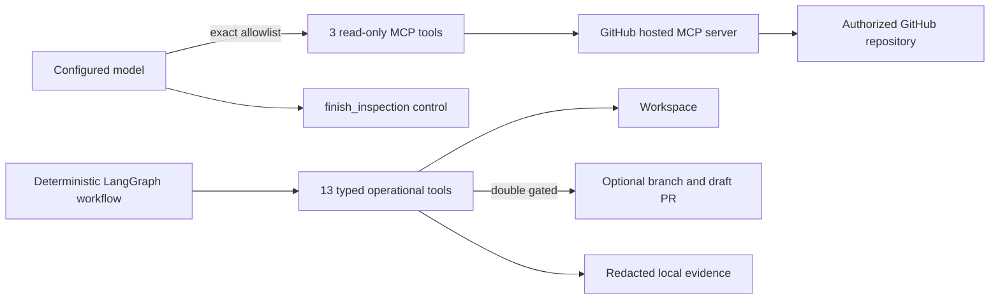

# AIOS Operational Tool Catalogue

> Generated from `src/remediation_agent/tools/catalog.py`; do not edit manually.

The Resolution/Remediation Agent implements **17 operational tools**: **4 model-callable** inspection/control tools and **13 deterministic workflow-only** tools. All tools belong to the same agent and shared LangGraph state; they are not agents or subagents.

## Authority boundary

Repository content cannot expand the allowlist, choose commands, call mutation tools, or grant remote-write authority. The workflow resolves policy-controlled arguments and invokes workflow-only tools deterministically.

## Implemented tools

| Tool ID | Description | Operation / typed boundary | Arguments | Category | Execution | Effect | Availability | Controls |
|---|---|---|---|---|---|---|---|---|
| `mcp.get_repository_tree` | Get a bounded repository tree from GitHub at the assigned immutable commit. | `get_repository_tree` / `GitHubRemoteMcpInspectionTools` | `owner`, `repo`, `tree_sha`, `recursive`, `path_filter` | `INSPECTION` | `MODEL_MCP` | `READ_ONLY` | `POLICY_GATED` | Exact GitHub repository and commit binding Forbidden-path filtering and entry limits One model tool call per inspection round |
| `mcp.get_file_contents` | Get bounded file or directory contents from GitHub at the assigned immutable commit. | `get_file_contents` / `GitHubRemoteMcpInspectionTools` | `owner`, `repo`, `path`, `ref`, `sha`, `fields` | `INSPECTION` | `MODEL_MCP` | `READ_ONLY` | `POLICY_GATED` | Secret, binary, forbidden-file, symlink, and mutable-ref denial Per-file and aggregate context limits Redacted typed results |
| `mcp.search_code` | Find candidate paths with GitHub code search; results are not commit-pinned evidence. | `search_code` / `GitHubRemoteMcpInspectionTools` | `query`, `sort`, `order`, `fields`, `page`, `perPage` | `INSPECTION` | `MODEL_MCP` | `READ_ONLY` | `POLICY_GATED` | Exact repository qualifier and cross-repository denial Result, pagination, timeout, and context limits Follow-up commit-pinned evidence required |
| `inspection.finish_inspection` | Signal that the adaptive inspection loop has gathered sufficient evidence. | `finish_inspection` / `LangChain control tool` | `rationale` | `INSPECTION` | `MODEL_CONTROL` | `CONTROL_ONLY` | `ALWAYS_BOUNDED` | No repository or mutation authority Requires at least one successful commit-pinned MCP call Bounded rationale schema |
| `repository.create_workspace` | Create a disposable repository workspace at the immutable requested base commit. | `create_workspace` / `RepositoryWorkspacePort` | — | `REPOSITORY` | `DETERMINISTIC_WORKFLOW` | `DISPOSABLE_WORKSPACE_WRITE` | `POLICY_GATED` | Repository allowlist and immutable-base verification Workflow-generated workspace identity Never model-callable |
| `repository.current_diff` | Retrieve and hash the current bounded workspace diff. | `current_diff` / `RepositoryWorkspacePort` | — | `REPOSITORY` | `DETERMINISTIC_WORKFLOW` | `READ_ONLY` | `POLICY_GATED` | Fixed Git argument arrays without a shell Pre-apply and post-validation integrity checks Never model-callable |
| `repository.create_branch` | Create the workflow-generated remediation branch after validation succeeds. | `create_branch` / `RepositoryWorkspacePort` | — | `REPOSITORY` | `DETERMINISTIC_WORKFLOW` | `DISPOSABLE_WORKSPACE_WRITE` | `CONFIG_AND_POLICY_GATED` | Validated branch naming Enabled only for configured GitHub writes Never model-callable |
| `repository.commit` | Commit the validated workspace diff with workflow-generated metadata. | `commit` / `RepositoryWorkspacePort` | — | `REPOSITORY` | `DETERMINISTIC_WORKFLOW` | `DISPOSABLE_WORKSPACE_WRITE` | `CONFIG_AND_POLICY_GATED` | Validated diff and configured Git identity Enabled only for configured GitHub writes Never model-callable |
| `repository.push` | Push only the workflow-generated remediation branch to the configured repository. | `push` / `RepositoryWorkspacePort` | — | `REPOSITORY` | `DETERMINISTIC_WORKFLOW` | `OPTIONAL_REMOTE_WRITE` | `CONFIG_AND_POLICY_GATED` | Application and operator-policy write gates Exact-host credential handling and idempotent branch scope Never model-callable and never merges |
| `sandbox.apply_patch` | Apply a preflighted unified patch inside the disposable workspace. | `apply_patch` / `SandboxExecutor` | — | `SANDBOX` | `DETERMINISTIC_WORKFLOW` | `DISPOSABLE_WORKSPACE_WRITE` | `POLICY_GATED` | Parsed path, diff, file-count, and forbidden-change checks Exact approved patch or diff scope Never model-callable |
| `sandbox.restore_base` | Restore the disposable workspace to its immutable base before revision. | `restore_base` / `SandboxExecutor` | — | `SANDBOX` | `DETERMINISTIC_WORKFLOW` | `DISPOSABLE_WORKSPACE_WRITE` | `ALWAYS_BOUNDED` | Runs only inside the assigned workspace Clean-base proof before a revised full patch Never model-callable |
| `sandbox.run_task` | Run one operator-defined validation task in the restricted Docker sandbox. | `run_task` / `SandboxExecutor` | — | `SANDBOX` | `DETERMINISTIC_WORKFLOW` | `DISPOSABLE_WORKSPACE_WRITE` | `POLICY_GATED` | Trusted argv arrays without a shell Non-root, no network, resource, timeout, and output limits Post-validation diff integrity check |
| `sandbox.destroy` | Destroy the assigned disposable workspace during mandatory cleanup. | `destroy` / `SandboxExecutor` | — | `SANDBOX` | `DETERMINISTIC_WORKFLOW` | `DISPOSABLE_WORKSPACE_WRITE` | `ALWAYS_BOUNDED` | Exact workspace identity and root containment Cleanup attempted for every workspace-owning terminal path Cleanup failure is surfaced in state and evidence |
| `pull_request.prepare` | Prepare a deterministic draft pull-request payload and metadata. | `prepare` / `PullRequestProvider` | — | `PULL_REQUEST` | `DETERMINISTIC_WORKFLOW` | `CONTROL_ONLY` | `POLICY_GATED` | Runs only after deterministic validation passes Workflow-generated title, body, branch, and idempotency key Creates no remote state |
| `pull_request.create_draft` | Create an optional draft pull request for the validated pushed branch. | `create_draft` / `PullRequestProvider` | — | `PULL_REQUEST` | `DETERMINISTIC_WORKFLOW` | `OPTIONAL_REMOTE_WRITE` | `CONFIG_AND_POLICY_GATED` | Application and operator-policy write gates Exact repository matching and idempotency key Draft only; merge is unavailable |
| `audit.write` | Write the redacted hash-chained JSONL audit trail for the run. | `write` / `AuditSink` | — | `EVIDENCE` | `DETERMINISTIC_WORKFLOW` | `LOCAL_EVIDENCE_WRITE` | `ALWAYS_BOUNDED` | Secret and path redaction Stable digests, UTC timestamps, and hash chaining Local artifact root containment |
| `artifact.write_bundle` | Write the bounded remediation evidence and handoff artifact bundle. | `write_bundle` / `ArtifactStore` | — | `EVIDENCE` | `DETERMINISTIC_WORKFLOW` | `LOCAL_EVIDENCE_WRITE` | `ALWAYS_BOUNDED` | Workflow-generated file names and contents Redaction and local artifact root containment Failure recorded in the final handoff |

## Model-callable subset

Only these tools are bound to the model during repository inspection:

- `get_repository_tree(owner, repo, tree_sha, recursive, path_filter)` — Get a bounded repository tree from GitHub at the assigned immutable commit.
- `get_file_contents(owner, repo, path, ref, sha, fields)` — Get bounded file or directory contents from GitHub at the assigned immutable commit.
- `search_code(query, sort, order, fields, page, perPage)` — Find candidate paths with GitHub code search; results are not commit-pinned evidence.
- `finish_inspection(rationale)` — Signal that the adaptive inspection loop has gathered sufficient evidence.

The first three operations are discovered from GitHub's hosted run-scoped MCP session and are restricted to the authorized repository and immutable commit. `finish_inspection` is a local control with no repository authority. Every other catalogue entry is workflow-only and is never included in model-visible tool schemas.
